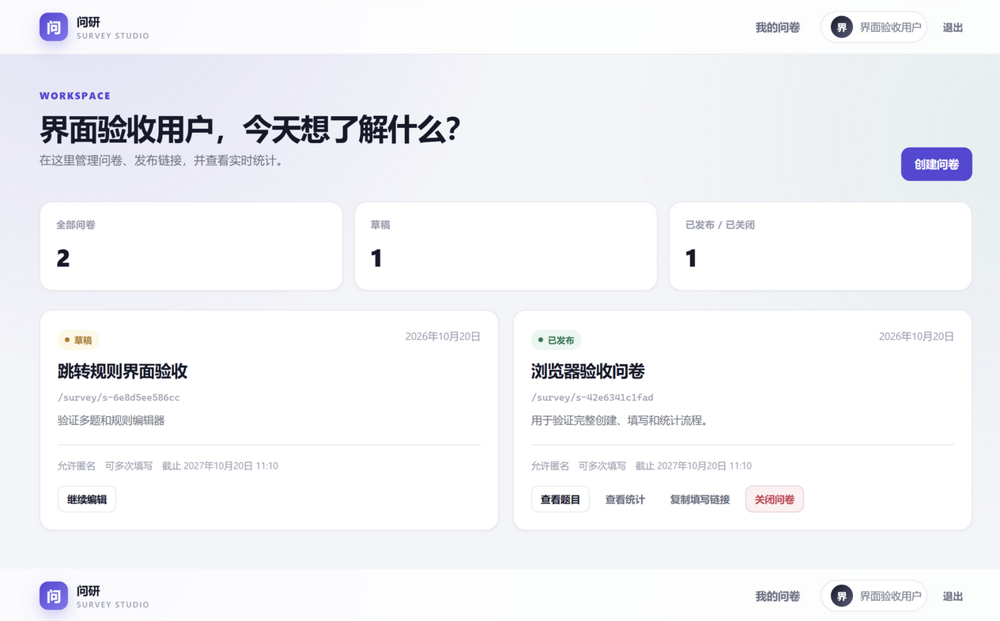
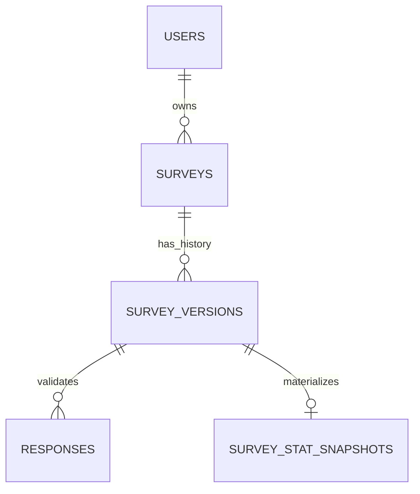

# 问研 Survey Studio — MongoDB 在线问卷系统

一个可以直接运行的在线问卷系统，后端使用 **FastAPI + Pydantic v2 + PyMongo**，
所有业务数据存储在 **MongoDB** 中，前端使用 **Jinja2 + 原生 JavaScript**，
不需要 Node.js 构建流程。



## 快速开始

环境要求：Python 3.11+、MongoDB 7/8（单机即可，不强制 Docker 或副本集）。

```bash
# 1. 安装依赖
pip install -r backend/requirements.txt

# 2. 配置环境
copy .env.example .env       # Windows
# cp .env.example .env       # macOS / Linux

# 3. 启动本地 MongoDB（如果尚未运行）
mkdir data
mongod --dbpath ./data

# 4. 初始化索引（AUTO_CREATE_INDEXES=true 时应用启动也会自动执行）
python -m backend.init_db

# 5. 从第一阶段升级数据（新库可跳过）
python scripts/migrate_phase2.py
python scripts/backfill_response_refs.py
python scripts/verify_migration.py

# 6. 启动应用
uvicorn backend.main:app --reload
```

打开：

- Web 界面：<http://127.0.0.1:8000/>
- API 文档：<http://127.0.0.1:8000/docs>
- 公开填写页：`http://127.0.0.1:8000/survey/{slug}`

首次使用先在 `/register` 注册账号。`.env` 中的 `JWT_SECRET` 必须替换为长随机字符串；
生产环境还应设置 `COOKIE_SECURE=true`。

## 已实现功能

- **账号**：用户名 + 邮箱注册、密码登录、Argon2id 密码哈希、JWT HttpOnly Cookie、
  Bearer Token、退出、当前用户。
- **问卷管理**：创建草稿、查看自己的问卷列表、查看详情、修改元数据、
  发布、关闭、设置/修改截止时间、幂等发布。
- **题目编辑**：单选、多选（最少/最多/指定数量）、文本（长度）、数字（整数开关/小数/区间）；
  整体草稿保存、题目排序、选项编辑、删除。
- **动态跳转**：每道题可配置多条跳转规则；支持单选、多选、数字比较；
  跳转规则存储在数据中，服务端在提交时重新计算路径，不信任浏览器。
- **公开填写**：按 `/survey/{slug}` 访问，逐题展示，服务端逐步计算下一题；
  支持匿名、登录填写、同账号多次填写策略、截止时间和关闭校验。
- **版本与运营**：已发布问卷可创建新版本草稿，修改后发布 vN+1；
  可调整已发布问卷的截止时间、匿名和多次填写策略，题目内容保持版本冻结。
- **统计**：整卷总览、单题详情、选项频次、作答人数、数字题均值/最值、
  文本回答分页。
- **运行保障**：单机 MongoDB 可运行、索引初始化、真实的注册/登录集成测试、
  并发匿名提交测试；不依赖 Docker 或 Playwright。

第二阶段（需求变更）新增：

- **题目库**：把题目保存为独立实体，可在任意问卷里重复使用；题目有版本历史
  （v1 → v2 → v3）、可恢复旧版本、可派生新题并记录来源。
- **共享**：把题目共享给其他用户（可查看 / 可使用），授权单独建集合，可随时撤销。
- **改题不伤旧问卷**：改题只生成新的题目版本；已发布问卷钉住它引用时的版本。
- **题库**：把题目整理成命名题库，可以从题库选题；题库引用题目实体，永远取最新版本。
- **反向查询**：查看某道题被哪些问卷（哪个版本）使用，改题前先看影响范围。
- **跨问卷统计**：一道题在所有问卷里的作答数、选项频次、数字均值/最值、文本回答分页。
- **迁移工具**：`scripts/migrate_phase2.py` 等四个脚本把第一阶段数据平滑升级，可重复执行。

## 页面

| 路径 | 页面 |
|---|---|
| `/login`、`/register` | 登录与注册 |
| `/dashboard` | 我的问卷 |
| `/surveys/{id}/edit` | 问卷编辑器 |
| `/surveys/{id}/stats` | 统计面板 |
| `/survey/{slug}` | 公开填写页 |
| `/questions` | 题目库（我的 / 共享 / 公开 / 题库） |
| `/questions/{id}` | 题目详情：版本历史、共享、被哪些问卷使用 |
| `/questions/{id}/stats` | 单题跨问卷统计 |
| `/libraries`、`/libraries/{id}` | 题库列表与题库内容 |

## API 与文档

- [完整 API 说明](docs/api.md)
- [系统测试用例](docs/system-test-cases.md)
- [AI 使用日志](docs/ai-usage-log.md)
- [项目完成报告（Markdown）](docs/project-report.md)
- [项目完成报告（Word）](docs/项目完成报告.docx)
- 管理端接口需要登录 Cookie 或 `Authorization: Bearer <token>`；
  公开填写接口在允许匿名的问卷中不需要登录。
- 详细集合划分、字段和索引见本文后续章节及 `schemas/` 目录。

## 测试

```bash
pip install -r backend/requirements-dev.txt
python -m pytest -v
```

测试会自动启动隔离的临时 `mongod` 和真实的 Uvicorn 服务；如果环境中没有 `mongod`，
可通过 `MONGODB_TEST_URI` 指向一个可丢弃的 MongoDB。测试不使用 Playwright。

当前全量测试为 **130 passed**：第一阶段 64 个用例的断言未改动，第二阶段新增 66 个，
覆盖题目版本、共享权限、题库、跨问卷统计、迁移兼容和新页面。

测试覆盖：创建问卷、添加四种题型、分支跳转、多选/数字校验、正常与匿名提交、
统计准确性、注册登录、权限隔离、关闭问卷、公开 Slug 填写、重复提交、草稿保存、
并发匿名提交、题目库与版本、共享、题库、跨问卷统计、迁移兼容和页面渲染。

## 当前边界

- 已发布问卷的题目内容不允许直接覆盖；可以从已发布版本创建新草稿，发布后旧版本和旧答卷保留。
- 统计默认展示当前发布版本；跨版本合并需要显式选择统计口径。
- 匿名答卷无法可靠去重，因此“仅允许一次”只对登录用户生效。
- 不依赖副本集事务：发布使用幂等状态推进和可恢复的两阶段写入，单机 MongoDB 可运行。
- Mongoose 模型作为结构参考保留；实际运行的后端使用 Pydantic + PyMongo。

---

# 数据库设计

> 以下保留第一阶段的数据库架构设计说明，包括集合划分、Schema 定义、
> MongoDB 选型论证与第二阶段兼容性分析。

## 0. 核心结论

第二阶段把“题目”从问卷版本里拆了出来，现在是 **9 个集合**：

| 集合 | 职责 | 增长方式 |
|---|---|---|
| `users` | 账户、密码哈希、账号状态 | 随注册用户增长 |
| `surveys` | 可变元数据、所有者、Slug、状态、截止时间、匿名策略、当前版本引用 | 每个问卷一条 |
| `survey_versions` | 不可变问卷内容快照：题目（含冻结内容）、选项、校验规则、跳转规则，以及指向题目库的 `question_ref` | 每次“发布新版本”新增一条 |
| `responses` | 一份提交 = 一个文档，内嵌答案数组；答案为可选的 `question_ref` | 随答卷量线性增长 |
| **`questions`** | 题目实体：稳定身份、所有者、可见性、最新版本指针、派生来源 | 每道题一条 |
| **`question_versions`** | 不可变题目内容快照：v1 → v2 → v3 | 每次改题新增一条 |
| **`question_shares`** | 题目共享授权（谁把哪道题共享给谁、什么权限） | 每次共享一条 |
| **`question_libraries`** | 题库元数据 | 每个题库一条 |
| **`question_library_items`** | 题库条目（题库 ↔ 题目） | 每加入一次一条 |
| `survey_stat_snapshots`（可选） | 可按版本重建的统计投影 | 每个问卷版本一条，可随时重算 |

三个关键决策：

1. **题目“引用 + 冻结快照”并存**。问卷版本内仍然保存完整题目内容（这就是快照），
   另外挂一个 `question_ref = {entity_id, version_id}` 提供跨问卷身份。
   快照负责“这一版问卷长什么样”，引用负责“这道题在全局是谁”，
   两者的一致性由发布时的内容哈希校验强制执行（见 §3.3）。
2. **答卷不内嵌进问卷，一次提交的全部答案内嵌在一个 `responses` 文档**。
   这样答卷写入是一次单文档原子插入，天然避免“问卷文档无限增长”和“16 MB 上限”，
   也不会对问卷文档形成写热点。答案额外记录 `question_ref`，用于跨问卷统计。
3. **发布后的 `survey_versions` 与任何 `question_versions` 都不可修改**。
   改问卷生成新的问卷版本；改题生成新的题目版本；答卷固定引用它答题时的版本。

如果必须在 FastAPI 和 Express 之间选一个，建议 **FastAPI + Pydantic v2 + PyMongo/Motor**：
Pydantic 的判别联合和跨字段校验更适合这种多态题目与逻辑图模型。Mongoose 版本也已给出，
用于团队选择 Express 时保持一致的数据契约。三套模型（Pydantic / JSON Schema / Mongoose）
对同一份题目内容计算出的 `content_hash` 完全一致，由 `scripts/verify_*` 交叉验证。

---

# 1. 集合划分与建模策略

## 1.1 关系模型



- `surveys.owner_id -> users._id`
- `survey_versions.survey_id -> surveys._id`
- `responses.survey_id -> surveys._id`
- `responses.survey_version_id -> survey_versions._id`
- `surveys.published_version_id` 指向当前对外的已发布版本；`current_draft_version_id` 指向正在编辑的草稿版本。
- `responses.respondent_id -> users._id`，匿名答卷必须为 `null`。

题目标识 `question_id`、选项标识 `option_id` 是版本内部的稳定字符串，不是数组下标。
题目顺序由 `questions` 数组顺序表示，但答案和跳转条件只认 ID，因此重排题目或选项不会错位。

## 1.2 为什么这样切分集合

### 为什么第二阶段把题目拆成独立集合，而不是继续内嵌

第一阶段内嵌的理由仍然成立：展示、校验、统计都需要一次读取完整题目图。
但需求变更提出了一个内嵌无法表达的问题——**同一道题要跨问卷存在**。
内嵌时 `question_id` 只是版本内字符串（`q_single_0001`），离开那一版问卷就没有意义，
于是“保存常用题、共享给他人、版本历史、被哪些问卷使用、跨问卷统计”五件事全部落空。

因此第二阶段改为“引用 + 冻结快照”：

- `questions` 提供跨问卷稳定的身份（ObjectId）、所有者与可见性；
- `question_versions` 提供不可变的内容版本（v1 → v2 → v3，`parent_version_id` 连成链）；
- `survey_versions.questions[]` 仍然保存完整内容（快照），另加 `question_ref`，
  于是第一阶段“一次读取即可展示 / 校验 / 统计”的结论完全没有退化；
- 一致性靠三条规则锁住：引用题的快照内容必须与所引版本哈希相同；
  要改内容只能生成新版本或 fork；发布时重算哈希，不一致直接拒绝发布。

代价是同一份内容存了两处，换来的是“读路径零退化 + 跨问卷身份”。
这正是 §3.2 讨论的“反范式冗余如何保证一致性”的具体答案。

> 第一阶段文档曾预言：“如果第二阶段真的出现题库、跨问卷共享题目、超大问卷块，
> 再增加集合并按版本引用即可，不需要推翻现有 `responses` 和统计口径。”
> 第二阶段正是按这个预案执行的：`responses` 的旧字段、统计管道的 5 个 `$facet`、
> 跳转引擎与校验引擎一行都没有改。

### 为什么答卷不内嵌到问卷

- 问卷的答卷数量无上限；内嵌会造成单文档无限增长，直接撞上 MongoDB 16 MB 限制。
- 即便未到 16 MB，每次提交都要重写越来越大的问卷文档，产生严重的写放大和文档锁竞争。
- 统计、分页、导出、匿名策略都需要独立查询答卷；独立集合可以建立索引和分片。
- 因此 `responses` 独立，且**一个提交用一个文档**，答案数组内嵌在该文档中。

### 为什么一个答卷文档内嵌答案数组，而不是 `answers` 独立集合

- 一次提交产生 300 条以内答案，规模有界；答案数组是自然的“提交快照”。
- 单文档插入是原子的，提交要么完整成功，要么完全失败，不需要跨文档事务。
- 统计中使用 `$unwind` 展开答案数组即可，不需要按题目做多次关联查询。
- 如果一条答案一个文档，高并发下写放大、排序、幂等和统计都更复杂，且没有收益。

### 为什么把“可变元数据”与“内容版本”分开

`surveys` 的标题、状态、截止时间、匿名策略会变化，但这些变化不应该改变旧答卷的题目定义。
`survey_versions` 则只保存发布时冻结的题目、选项、校验和跳转图。于是：

- 问卷列表、所有权、URL、截止时间查询走 `surveys`；
- 填答展示、答案校验、统计口径走 `survey_versions`；
- 答卷同时保存 `survey_id` 和 `survey_version_id`，定位明确。

### 为什么用户不内嵌问卷列表

用户集合保持小文档。问卷列表通过 `{ owner_id: 1, updated_at: -1 }` 索引查询，
避免用户文档随创建的问卷增长，也避免“查看自己的问卷”变成扫描用户文档中的大数组。

## 1.3 避免 16 MB 限制和“宽表陷阱”

本设计采用以下硬边界（在应用层和 Schema 层同时校验）：

| 项目 | 上限 | 原因 |
|---|---:|---|
| 每个版本的题目数 | 300 | 控制版本文档和单份答卷大小 |
| 单选题/多选题选项数 | 100 | 控制题目定义和答案数组大小 |
| 单题标题 | 500 字符 | 展示和文档体积 |
| 单题描述 | 2,000 字符 | 展示和文档体积 |
| 选项标签 | 500 字符 | 展示和文档体积 |
| 每条文本答案 | 5,000 字符 | 控制答卷体积；按 Unicode 码点计 |
| 一次答卷答案数 | 300 | 与题目数一致 |
| 单份答卷序列化大小 | 应用层 8 MB 硬保护 | 远低于 16 MB，留出 BSON 开销余量 |
| 单个版本序列化大小 | 应用层 8 MB 硬保护 | 题目文本/选项组合极值时仍不撞上限 |

按最坏情况估算：300 道纯文本题 × 5,000 个 Unicode 码点 × 最大 4 字节 ≈ 6 MB，
加 BSON 字段和少量元数据仍低于 8 MB；其他题目类型不会比文本更长。附件、图片、
音频不进入文档，第二阶段应使用 GridFS 或对象存储，仅在答案中存引用。

“宽表陷阱”指把每道题做成一个固定列（`q1`、`q2`、……）。本设计不这样做：
一份答卷内是 `answers: [{question_id, type, ...}]` 的数组，题目增加只增加数组元素，
不需要改集合结构，也不会产生大量稀疏字段。统计时按 `question_id` 过滤后展开。

## 1.4 索引设计

写路径越短越好，尤其是 `responses`，因此只保留必要索引。

| 集合 | 索引 | 用途 |
|---|---|---|
| `users` | `{ email: 1 }` unique | 登录、注册唯一性 |
| `surveys` | `{ slug: 1 }` unique | 公开 URL |
| `surveys` | `{ owner_id: 1, created_at: -1 }` | 仅查看自己的问卷 |
| `surveys` | `{ status: 1, closes_at: 1 }` | 定时关闭任务 |
| `survey_versions` | `{ survey_id: 1, version_no: 1 }` unique | 版本号唯一 |
| `survey_versions` | `{ survey_id: 1, state: 1 }` | 查找当前草稿/发布历史 |
| `responses` | `{ survey_id: 1, submission_token: 1 }` unique | 提交幂等，防止重复写入 |
| `responses` | `{ survey_id: 1, submitted_at: -1 }` | 答卷列表、导出、总统计 |
| `responses` | `{ survey_id: 1, survey_version_id: 1, submitted_at: -1 }` | 按版本统计 |
| `responses` | `{ survey_id: 1, survey_version_id: 1, "answers.question_id": 1 }` | 单题统计、文本分页前置过滤 |
| `responses` | `{ survey_id: 1, respondent_id: 1 }` partial | 可选：按登录用户查询 |
| `survey_stat_snapshots` | `{ survey_id: 1, survey_version_id: 1 }` unique | 每版本一个统计快照 |

不使用 `$inc` 在问卷文档上维护实时答卷数：那会让一个热门问卷的所有提交竞争同一文档。
总数用 `countDocuments` 或在统计投影中维护；高频写入不被计数阻塞。

---

# 2. 每个集合的完整结构定义

## 2.1 统一约定

- **格式**：JSON Schema Draft 2020-12；MongoDB 物理类型为 BSON，JSON 表示中用 24 位十六进制字符串表示 ObjectId。
- **时间**：统一 UTC，服务端生成 `submitted_at`、`published_at`，不信任客户端时间。
- **命名**：所有格式统一使用 `snake_case`，避免 Python/Node 两套命名映射。
- **版本字段**：
  - 集合文档的 `schema_version`：物理文档结构版本，当前为 `1`；
  - `survey_versions.content_schema_version`：题目/逻辑 DSL 语义版本，当前为 `1`。
- **严格写入**：Pydantic `extra="forbid"`，Mongoose `strict: "throw"`。未知字段宁可拒绝，不静默丢弃。
- **跨字段校验**：JSON Schema 负责结构；Pydantic 模型校验器和 Mongoose `pre("validate")` 负责
  唯一 ID、跳转目标、操作符与题目类型匹配等语义约束；服务端在发布和提交时再次校验。

完整定义文件：

| 层级 | 文件 |
|---|---|
| 公共题目/答案/跳转定义 | [`schemas/json-schema/common.schema.json`](schemas/json-schema/common.schema.json) |
| 用户 | [`schemas/json-schema/users.schema.json`](schemas/json-schema/users.schema.json) |
| 问卷元数据 | [`schemas/json-schema/surveys.schema.json`](schemas/json-schema/surveys.schema.json) |
| 问卷版本与题目/跳转 | [`schemas/json-schema/survey_versions.schema.json`](schemas/json-schema/survey_versions.schema.json) |
| 答卷 | [`schemas/json-schema/responses.schema.json`](schemas/json-schema/responses.schema.json) |
| 统计快照 | [`schemas/json-schema/survey_stat_snapshots.schema.json`](schemas/json-schema/survey_stat_snapshots.schema.json) |
| Pydantic 模型 | [`schemas/pydantic/models.py`](schemas/pydantic/models.py) |
| 跳转/提交校验参考实现 | [`schemas/pydantic/engine.py`](schemas/pydantic/engine.py) |
| Mongoose 模型 | [`schemas/mongoose/models/`](schemas/mongoose/models/) |
| 完整示例 | [`examples/`](examples/) |

## 2.2 `users`

| 字段 | 类型 | 说明 |
|---|---|---|
| `_id` | ObjectId | 主键 |
| `schema_version` | int = 1 | 物理结构版本 |
| `username` | string | 3–32 位小写字母/数字/下划线；唯一索引；登录标识 |
| `email` | string | 统一小写、唯一索引 |
| `password_hash` | string | Argon2id 编码后的哈希；绝不保存明文 |
| `display_name` | string | 1–80 字符 |
| `status` | enum | `active` / `disabled` |
| `last_login_at` | date \| null | 最后登录时间 |
| `created_at`, `updated_at` | date | 创建/更新时间 |

“仅查看自己创建的问卷”不是数据库权限能自动保证的：服务层所有问卷查询必须强制附加
`owner_id = current_user._id`，不能接受客户端传入所有者 ID；用户 ID 从登录态取得。

## 2.3 `surveys`

| 字段 | 类型 | 说明 |
|---|---|---|
| `_id` | ObjectId | 主键 |
| `schema_version` | int = 1 | 物理结构版本 |
| `owner_id` | ObjectId | 创建者；所有管理操作先校验 |
| `slug` | string | 公开 URL；唯一；发布后不可修改 |
| `title`, `description` | string | 可变展示元数据，不属于答题语义 |
| `status` | enum | `draft` / `published` / `closed` |
| `allow_anonymous` | bool | 是否允许未登录/匿名填写 |
| `allow_multiple_responses` | bool | 是否允许同一登录用户多次提交 |
| `opens_at`, `closes_at` | date \| null | 开放窗口；服务端 UTC |
| `current_draft_version_id` | ObjectId \| null | 当前编辑中的版本 |
| `published_version_id` | ObjectId \| null | 当前对外的已发布版本 |
| `last_version_no` | int | 已分配的最大版本号 |
| `published_at`, `closed_at` | date \| null | 发布时间、关闭时间 |
| `deleted_at` | date \| null | 软删除；不级联破坏历史答卷 |
| `created_at`, `updated_at` | date | 时间戳 |

生命周期建议：

1. 创建：`status=draft`，同时创建 `version_no=1` 的草稿版本；
2. 编辑：只修改草稿版本，使用 `revision` 做乐观锁；
3. 发布：在同一事务中校验版本、写入 `published_at/content_hash`、更新
   `surveys.published_version_id/published_at/status`；
4. 发布后再编辑：克隆已发布版本为新的草稿，发布时生成 `version_no+1`；
5. 关闭：`status=closed`，并保留 `published_version_id`，历史答卷仍可解释；
6. 删除：软删除；是否物理清除历史数据由保留策略异步处理。

`allow_anonymous`、截止时间等属于问卷级策略，可以变化；每条答卷会记录实际接受的
`is_anonymous` 和服务端 `submitted_at`，因此策略变化不会污染历史记录。

## 2.4 `survey_versions`

字段：

| 字段 | 类型 | 说明 |
|---|---|---|
| `_id` | ObjectId | 版本主键；答卷引用它 |
| `schema_version` | int = 1 | 文档物理结构版本 |
| `survey_id` | ObjectId | 所属问卷 |
| `version_no` | int | 问卷内递增、唯一 |
| `state` | enum | `draft` / `published` |
| `content_schema_version` | int = 1 | 题目和 DSL 版本 |
| `revision` | int | 草稿乐观锁版本 |
| `questions` | array\<Question\> | 1–300 道题，数组顺序即主流程顺序 |
| `created_by` | ObjectId | 创建者 |
| `created_at`, `updated_at` | date | 时间戳 |
| `published_at` | date \| null | 发布后不可再改 |
| `content_hash` | string \| null | 规范化内容的 SHA-256，用于审计和重复发布检测 |

### 题目判别联合

```text
Question =
  SingleChoiceQuestion { type: "single_choice", options[] }
  MultiChoiceQuestion  { type: "multi_choice",  options[], validation }
  TextQuestion         { type: "text",          validation }
  NumberQuestion       { type: "number",        validation }
```

公共字段：

| 字段 | 类型 | 说明 |
|---|---|---|
| `question_id` | string | 稳定 ID（`q_...`） |
| `type` | enum | 四种题型之一 |
| `title` | string | 1–500 字符 |
| `description` | string | 可选，最多 2,000 字符 |
| `required` | bool | 是否必须在**实际展示路径**上作答 |
| `logic` | JumpLogic | 可选，题目级跳转规则 |

题型专属规则：

| 题型 | 字段 | 规则 |
|---|---|---|
| 单选 | `options[{option_id, label}]` | 2–100 个；作答时恰好选 1 个 |
| 多选 | `options[]`, `validation` | 至少/至多/指定选择数；选项 ID 唯一 |
| 文本 | `validation` | `min_length`、`max_length`、`trim`；长度按 Unicode 码点 |
| 数字 | `validation` | `integer` 可配置；`integer=true` 只允许安全整数，`integer=false` 允许有限小数；`min`/`max` 为闭区间 |

多选题校验：

```json
{
  "validation": {
    "min_selected": 1,
    "max_selected": 3
  }
}
```

`exact_selected` 与 `min_selected`/`max_selected` 互斥；`min`/`max` 是闭区间。
`required=false` 时可以不回答；一旦提交多选答案，`min_selected` 等仍然生效。
单选、选项数量等约束在发布时校验，提交时再次按固定版本校验。

## 2.5 动态跳转逻辑（数据驱动）

跳转规则存放在**题目所属的 `logic` 对象**中，不是代码里的 `if survey_id == ...`。
版本发布后规则固定，答卷按固定版本执行。

```json
{
  "logic": {
    "fallback": { "action": "next" },
    "rules": [
      {
        "rule_id": "r_rating_low_004",
        "when": {
          "mode": "all",
          "conditions": [
            {
              "question_id": "q_rating_0004",
              "operator": "lt",
              "value": 4
            }
          ]
        },
        "then": {
          "action": "goto",
          "target_question_id": "q_improve_0005"
        }
      }
    ]
  }
}
```

语义：

1. 题目按 `questions` 数组顺序推进；默认下一题。
2. 当前题目处理完后，按 `rules` 数组顺序评估，**第一条命中的规则生效**；
   未命中则使用 `fallback`（`next` 或 `end`）。
3. `when.mode=all` 表示所有条件成立，`any` 表示任一成立。
4. 条件可以引用当前题或更早的题；引用尚未展示或未作答的题一律视为“不成立”。
5. `goto` 目标必须位于当前题之后，禁止回跳，因此逻辑天然是无环的；
   这避免配置出无限循环，也让服务端重放路径有确定上限。
6. 问卷在 `end` 处结束；只有实际路径上的题目才检查 `required`。
7. 条件和目标都使用 `question_id`，不用题目下标。

持久化字段仍是 `logic.rules`，模型中额外提供只读属性 `question.jump_rules`
作为别名，不引入第二份跳转数据。引擎的纯函数入口：

```text
validate_answer(question, answer)                         -> 校验单题
evaluate_jump(question, answer, prior_answers=...)        -> JumpDecision(goto/next/end)
evaluate_next_question(question, answer)                  -> 显式跳转目标或 None
validate_submission(version, answers)                     -> 重放整页路径并返回规范化答案
```

运算符采用注册表而不是 if/elif 堆叠；`contains` 等新运算符可以通过
`OperatorRegistry.register(...)` 注册，再随新的内容 Schema 版本持久化。

操作符与题型约束：

| 源题型 | 操作符 | `value` 形式 | 含义 |
|---|---|---|---|
| 单选 | `eq`, `neq` | 单个 `option_id` | 等于/不等于某选项 |
| 单选 | `in`, `not_in` | `option_id` 数组 | 属于/不属于选项集合 |
| 多选 | `includes_any` | `option_id` 数组 | 至少选中一个 |
| 多选 | `includes_all` | `option_id` 数组 | 包含全部 |
| 多选 | `includes_none` | `option_id` 数组 | 一个都不包含 |
| 多选 | `equals_set` | `option_id` 数组 | 选择集合完全相等 |
| 多选 | `selection_count_eq/gte/lte` | 非负整数 | 选择数量比较 |
| 数字 | `eq`, `neq`, `gt`, `gte`, `lt`, `lte` | 安全整数 | 数字比较 |
| 数字 | `between` | `[low, high]` | 闭区间 |

发布语义校验会拒绝：

- 重复 `question_id` / `option_id` / `rule_id`；
- 条件引用不存在的题或更晚的题；
- 操作符与源题型不匹配；
- 条件中的选项不属于源题；
- `goto` 目标不存在、是当前题或更早的题；
- `exact_selected` 与 min/max 冲突、区间倒置、选择上限超过选项数；
- 已发布版本缺少 `published_at` 或 `content_hash`。

### 服务端执行，而不是信任浏览器

浏览器可以为了交互提前执行同一份规则，但最终提交必须以服务端为准：

1. 读取答卷固定引用的已发布版本；
2. 将提交答案按 `question_id` 建映射，先拒绝重复、未知题目；
3. 从第一题开始重放：
   - 当前题有答案则按题型和版本规则校验；无答案且 `required=true` 则拒绝；
   - 用已展示且已校验的答案评估规则；
   - 执行 `goto` / `end` / 默认下一题；
4. 重放结束后，拒绝为“未出现在实际路径上的题目”提交的答案；
5. 只持久化服务端重排、裁剪后的答案列表。

参考实现见 [`schemas/pydantic/engine.py`](schemas/pydantic/engine.py)，示例覆盖了：
单选身份分流、多选实验分支、数字满意度分支、文本补充题和最终推荐题。

## 2.6 `responses`

字段：

| 字段 | 类型 | 说明 |
|---|---|---|
| `_id` | ObjectId | 答卷主键 |
| `schema_version` | int = 1 | 物理结构版本 |
| `survey_id` | ObjectId | 所属问卷 |
| `survey_version_id` | ObjectId | 固定引用的题目版本 |
| `respondent_id` | ObjectId \| null | 匿名时必须为 `null` |
| `is_anonymous` | bool | 匿名标记；与上述字段共同构成不变量 |
| `submission_token` | string | 客户端生成、问卷内唯一；重复提交幂等 |
| `answers` | array\<Answer\> | 0–300 条；由服务端校验并排序 |
| `submitted_at` | date | 服务端接受时间，不使用客户端时间 |

答案判别联合：

```text
SingleChoiceAnswer { question_id, type: "single_choice", option_ids: [one id] }
MultiChoiceAnswer  { question_id, type: "multi_choice",  option_ids: [1..100] }
TextAnswer         { question_id, type: "text",          text }
NumberAnswer       { question_id, type: "number",        number: finite int/decimal }
```

不变量与保证：

- `(survey_id, submission_token)` 唯一索引保证重试不产生重复答卷；
- 一份答卷最多一条题目答案；重复题 ID 拒绝；
- 匿名：`is_anonymous=true => respondent_id=null`。匿名提交不存原始 IP、UA 或可关联身份；
- 身份型：`is_anonymous=false => respondent_id` 必填；
- 答案只能引用固定版本中存在的题目和选项，且只能属于实际展示路径；
- 一次插入完成，不需要跨文档事务；
- 提交时间以服务端接受为准。

高并发写路径：

1. 从缓存/数据库读取已发布版本，检查问卷状态、开放时间、截止时间；
2. 校验匿名资格、幂等 token；
3. 纯内存执行跳转重放和答案校验；
4. 一次 `insertOne` 写入 `responses`，返回答卷 ID；
5. 不同步更新问卷计数；统计走异步计算或投影。

必要时可增加响应式限流（尤其是匿名问卷），但不把限流状态写入每份答卷。

## 2.7 `survey_stat_snapshots`（可选投影）

这个集合不是事实来源，而是为了大量答卷时减少重复聚合。文档按
`(survey_id, survey_version_id)` 唯一，保存：

- `response_count`：快照时的提交总数；
- 每题的 `answered_count`；
- 单选/多选：每个选项的 `option_counts`；
- 数字题：`sum/avg/min/max`；
- 文本题：只保存作答数量，不复制文本内容；
- `latest_submitted_at`、`computed_at`：水位和计算时间。

统计必须按版本分开，因为不同版本的选项、题目定义可能变化。只有题目和选项
ID 保持稳定、语义未变时，才适合做跨版本合并。快照可以从 `responses` 全量重建，
因此允许最终一致；原始答卷仍是唯一事实来源。

不建投影时，直接聚合也可以满足第一阶段：

```js
// 数字题：平均分
db.responses.aggregate([
  { $match: { survey_id: surveyId, survey_version_id: versionId } },
  { $unwind: "$answers" },
  { $match: { "answers.question_id": "q_rating_0004", "answers.type": "number" } },
  { $group: {
      _id: null,
      count: { $sum: 1 },
      avg: { $avg: "$answers.number" },
      min: { $min: "$answers.number" },
      max: { $max: "$answers.number" }
  }}
])
```

单选：按 `answers.option_ids` 展开后按 `option_id` 分组计数。
多选：同样展开 `option_ids` 后计数；这是选择频次，不是互斥占比。
文本：按题 ID 过滤后分页返回 `answers.text`，只允许问卷所有者访问。
百分比的分母建议使用该题的 `answered_count`，而不是提交总数，避免跳题/跳过分支造成误导。

---

## 2.8 `questions`（第二阶段新增：题目实体）

| 字段 | 类型 | 说明 |
|---|---|---|
| `_id` | ObjectId | 题目身份，跨问卷稳定 |
| `owner_id` | ObjectId → `users` | 所有者；只有所有者能改题、共享、删除 |
| `root_entity_id` | ObjectId | 血统根，用于“同族题目”查询 |
| `source_entity_id` / `source_version_id` | ObjectId \| null | fork 来源（“新题是从哪道题改来的”） |
| `lineage_depth` | int | fork 代数，自身为 0 |
| `type` / `title` | string | 冗余字段，列表筛选与展示不必读版本 |
| `visibility` | `private` / `shared` / `public` | 私有、授权可见、全站可用 |
| `latest_version_id` / `latest_version_no` / `version_count` | | 版本指针与计数 |
| `deleted_at` | Date \| null | 软删除；被已发布问卷引用时禁止删除 |

## 2.9 `question_versions`（第二阶段新增：不可变题目版本）

| 字段 | 类型 | 说明 |
|---|---|---|
| `entity_id` | ObjectId → `questions` | 所属题目 |
| `version_no` | int ≥1 | 从 1 递增，`(entity_id, version_no)` 唯一 |
| `parent_version_id` | ObjectId \| null | 上一版本；v1 必须为 null，v2+ 必须非空 |
| `restored_from_version_id` | ObjectId \| null | “恢复旧版本”时记录来源 |
| `content` | `QuestionContent` | 判别联合：题型 + 标题/说明/必答/选项/校验 |
| `content_hash` | 64 位十六进制 | 内容的 sha256；模型层校验必须与 `content` 一致 |
| `legacy_key` | string \| null | 迁移幂等键 `"{survey_version_id}:{question_id}"` |

**没有任何代码路径会更新已写入的版本**；改题 = 插入 `version_no + 1`。
题目内容里刻意不含 `question_id`（问卷内实例 ID）与 `logic`（跳转规则），
因为这两者依赖问卷内的位置，抽出去才能复用。

## 2.10 `question_shares`（第二阶段新增：共享授权）

`{entity_id, grantee_id, permission(view|use), granted_by, created_at}`，
`(entity_id, grantee_id)` 唯一。`use` 表示可以插入自己的问卷，`view` 只能查看。
单独建集合而不是在题目里内嵌数组，因为共享对象数量没有上限（可以共享给整个班级），
并且需要独立撤销与审计。

## 2.11 `question_libraries` / `question_library_items`（第二阶段新增：题库）

- `question_libraries`：`{owner_id, name, description, visibility(private|public)}`，
  `(owner_id, name)` 唯一。
- `question_library_items`：`{library_id, entity_id, added_by, added_at, note, tags}`，
  `(library_id, entity_id)` 唯一。

条目引用的是**题目实体**而不是某个版本，所以“题库里的题可以更新版本”是自然结果：
题库里取到的永远是这道题的最新版本。

## 2.12 第二阶段新增索引

```text
questions:              { owner_id: 1, updated_at: -1 }        我的题目列表
questions:              { root_entity_id: 1 }                   同族题目
questions:              { owner_id: 1, type: 1, deleted_at: 1 }  按题型筛选
question_versions:      { entity_id: 1, version_no: 1 } unique  版本唯一
question_versions:      { entity_id: 1, created_at: -1 }        版本历史
question_versions:      { parent_version_id: 1 }                子版本
question_versions:      { legacy_key: 1 } unique partial        迁移幂等
question_shares:        { entity_id: 1, grantee_id: 1 } unique
question_shares:        { grantee_id: 1, created_at: -1 }       共享给我的
question_libraries:     { owner_id: 1, name: 1 } unique
question_libraries:     { visibility: 1, updated_at: -1 }       公开题库
question_library_items: { library_id: 1, entity_id: 1 } unique
question_library_items: { entity_id: 1 }                        此题被哪些题库收录
survey_versions:        { questions.question_ref.entity_id: 1 }        ← 反向查询（多键）
survey_versions:        { questions.question_ref.version_id: 1 }       ← 版本级使用
responses:              { answers.question_ref.entity_id: 1, submitted_at: -1 }  ← 跨问卷统计
responses:              { answers.question_ref.version_id: 1 }
```

后四条是第二阶段最重要的两条查询的支撑：
“这道题被哪些问卷用了”（反向查询）与“这道题在所有问卷里怎么答的”（跨问卷统计），
都从集合扫描变成多键索引扫描。

## 2.13 六条不变式

| # | 不变式 | 强制位置 |
|---|---|---|
| I1 | `question_versions` 只插入不更新，改题 = 新增 `version_no+1` | 服务层无更新路径；Mongoose `pre('save')` 兜底 |
| I2 | 问卷版本中带 `question_ref` 的题目，内容哈希必须等于所引用版本 | `replace_draft`、`publish_survey` 校验 |
| I3 | 同一 `survey_versions` 内 `question_ref.entity_id` 不得重复 | 保存草稿、从题库插入 |
| I4 | 答卷答案的 `question_ref.version_id` 必须等于该问卷版本中该题的引用版本 | 提交时由服务端写入，客户端传的会被丢弃 |
| I5 | 被任一已发布问卷版本引用的题目不得硬删除，只能软删 | `delete_question` |
| I6 | 同一题目内 `option_id` 跨版本稳定：按 label 继承旧 ID，只给新选项分配新 ID | 生成新版本时合并选项 |

I6 是跨版本统计能按 `option_id` 合并的前提；改名视为“旧选项删除 + 新选项新增”。
I2 是“反范式冗余”能成立的前提——内容存了两处，但只允许有一个权威版本。

# 3. 两个报告必答的架构问题

## 3.1 为什么该业务场景适合 MongoDB，而不是传统关系型数据库？

**核心原因是聚合边界与访问模式。**

1. **题目是天然多态结构。**
   单选题需要选项；多选题需要选项和最少/最多/指定数量；文本题需要长度限制；
   数字题需要可配置的整数约束和上下界。关系库通常要在
   `questions + options + question_validation + jump_rules` 多张表之间拆分，
   或者使用大量稀疏列/EAV。MongoDB 将不同类型的题目作为带 `type` 判别字段的
   子文档，存于同一版本文档，既能严格校验，也不需要为每种题型建表。

2. **一次答题会话天然是文档聚合。**
   展示问卷只需读取一个不可变版本快照；提交答卷只需插入一个文档。
   关系库中一份答卷通常要拆成 `submissions` 与 `answers` 多行，插入需要事务，
   统计需要大量连接。本设计的写路径是一写一文档，读取是一读一版本文档，
   这正好符合 MongoDB 的强项。

3. **版本快照与历史一致性。**
   把题目、选项和跳转规则整体冻结在一个版本文档里，旧答卷永久可解释。
   关系库可以通过版本表实现，但每次展示和统计都需要多表连接并保证连接到的
   是同一版本；MongoDB 的文档快照更直接。`content_hash` 还能审计发布内容。

4. **跳转逻辑是面向读的嵌套配置。**
   `logic.rules[].when.conditions[]` 是每个问卷自定义的可变结构。
   在关系库中它通常会被塞进 JSON 列或变成规则表，前者回到文档模型，
   后者需要复杂的自连接和运行时拼接。这里把它作为版本的子文档，
   由统一解释器执行，结构清晰且天然按版本冻结。

5. **高并发答卷是“插入型”负载。**
   独立 `responses` 集合、每次提交一个文档、无跨表事务、无共享计数器，
   容易横向扩展和分片。关系库也能达到高吞吐，但需要更谨慎地处理
   答卷行、答案行、计数行之间的锁竞争和多表事务。

6. **演进成本更低。**
   第二阶段增加题型、增加逻辑操作符或增加展示字段时，可在版本化判别联合中
   新增分支，不必对老数据做 `ALTER TABLE`；旧版本文档和旧答卷保持原样。

**但不应把 MongoDB 说成“任何场景都优于关系库”。** 本系统仍需处理归属、唯一性、
发布一致性等约束；因此配合唯一索引、发布事务、严格的应用层语义校验和版本冻结。
如果未来出现了强跨实体事务的计费、结算、复杂报表自助关联分析，应采用专门服务
或关系型分析库，而不是强行把所有东西塞进一个 MongoDB 文档。

## 3.2 如何平衡反范式冗余与数据一致性？

原则是：**只冗余不可变、可验证的事实；每个事实只有一个权威来源；派生数据单独存放并允许重建。**

| 反范式数据 | 冗余在哪里 | 为什么 | 一致性保证 |
|---|---|---|---|
| 题目、选项、跳转规则 | 整份快照内嵌在 `survey_versions` | 一次读取完整问卷，版本可审计 | 发布后版本不可变，服务层禁止修改；发布前语义校验；`content_hash` |
| 一次提交的全部答案 | 内嵌在 `responses` | 单文档原子写入，避免多表事务和 16 MB 增长 | 服务端按固定版本重放和校验；一次插入；答案题 ID 唯一 |
| `responses.survey_id`、`survey_version_id` | 答卷中保存两个引用 | 不依赖反查版本即可做路由/统计 | 写入时由服务端赋值；版本永久保留；不复制题目正文 |
| `responses.is_anonymous` | 与 `respondent_id` 共同保存 | 明确审计匿名事实，便于索引/统计 | 强制不变量：匿名 ⇔ `respondent_id=null`；写入后不更新 |
| `respondent_id` | 只保存 ID，不冗余邮箱/昵称 | 避免用户改名导致历史答卷信息错误 | 用户信息以 `users` 为唯一来源；展示时按需关联；匿名时为空 |
| 统计计数 | 可选的 `survey_stat_snapshots` | 避免每次仪表盘扫描全部答卷 | 只是投影；带水位和 `computed_at`；可全量重建；原始 `responses` 权威 |

关键的取舍：

- **不复制题干、选项标签到每份答卷。** 那样会让答卷随文本膨胀，而且标签改动后
  旧答卷中会出现一份不明来源的“副本”。本设计只用 `survey_version_id` + 题目/选项 ID，
  解释权和一致性都在冻结版本上。
- **不冗余实时总数到 `surveys`。** 热门问卷的 `$inc` 会形成单文档热点；
  计数改为查询/投影，牺牲一点实时性换取写入吞吐。
- **不把统计结果当事实表。** 快照是可重算的读取优化，不是与答卷同等的事实。
  这样统计滞后、重建、回填都不会影响答卷正确性。
- **唯一性交给数据库索引。** `slug`、`email`、`(survey_id, version_no)`、
  `(survey_id, submission_token)` 都用唯一索引兜底，而不是“先查再写”的竞态逻辑。
- **发布使用事务。** “版本变为 published + 更新问卷当前发布指针”必须原子完成；
  否则可能出现问卷已上线但版本仍为草稿，或反之。MongoDB 副本集支持该事务。
- **单文档内一致性交给 MongoDB。** 答卷答案数组和版本题目图各自在一个文档内，
  不需要分布式事务；跨文档的引用由服务层发布校验和提交校验维护。
- **接受非关键路径的最终一致。** 统计快照、搜索索引、导出缓存可以延迟；
  答卷接收、匿名策略、截止时间和所有者鉴权必须在主路径强校验。

## 3.3 向后兼容与第二阶段演进

把“版本”拆成三条独立轴线：

1. `schema_version`：集合文档的物理结构；
2. `content_schema_version`：题目/跳转 DSL 语义；
3. `survey_version_id`：每份答卷固定的业务内容快照。

第二阶段的变化按以下方式落地，现有数据无需重写：

| 第二阶段可能变化 | 演进方式 |
|---|---|
| 新增题型（评分、矩阵、文件） | 在 `Question` / `Answer` 判别联合中新增分支和新校验模型；旧版本不受影响。文件只保存对象存储/GridFS 引用 |
| 新增跳转操作符/组合条件 | 新增枚举值和解释器分支；已有规则语义不变。需要改变旧语义时才提升 `content_schema_version` |
| 题目顺序、文案、选项修改 | 复制为新草稿版本并发布 `version_no+1`；历史答卷仍指向旧版本 |
| 多表单、分页、随机题序 | 在版本内容中新增可选字段；旧版本读取时使用默认行为 |
| 团队协作、权限 | 新增独立集合（如 `survey_collaborators`），不把成员数组塞回用户或问卷主文档 |
| 答卷编辑/审计 | 新增不可变修订集合；原答卷保留，不能就地覆盖改变统计事实 |
| 超大题量/题库复用 | 将版本内容改为外部块引用，新增“存储布局”字段；旧内嵌版本继续可读 |
| 大流量统计 | 重建/增量更新 `survey_stat_snapshots`；不改原始答卷 |

兼容规则：

- **只做加法**：新增字段必须有默认语义，绝不复用已有字段表达新含义；
- **旧代码拒绝未知版本**：读取到高于自身支持的 `schema_version` 或
  `content_schema_version` 时明确报错，不能猜测；
- **新代码读旧数据**：解释器必须同时支持历史 DSL 版本；旧答卷不迁移；
- **不批量回填旧文档**：回填只用于可选的统计投影；原始版本和答卷保持不可变；
- **统计按版本展示**：不同版本之间只合并 ID 与语义都稳定的题目，否则分别展示。

---

## 3.4 第二阶段实际落地（需求变更 → 数据结构 → 程序）

需求变更提出 8 条诉求，落到系统里是这样一组改动：

| # | 用户诉求 | 数据结构 | 程序 |
|---|---|---|---|
| 1 | 保存常用题目、做新问卷时直接选用 | 新增 `questions` + `question_versions` | `POST /api/questions`、问卷侧“从题库插入” |
| 2 | 把题目共享给同事 | 新增 `question_shares` + `visibility` | 共享/撤销接口与权限判定 |
| 3 | 改题不影响已发布问卷 | 改题 = 新增版本 | 禁止原地改版本；问卷只钉住某个 `version_id` |
| 4 | 看修改历史、知道来源、能恢复 | `parent_version_id`、`restored_from_version_id`、`source_entity_id` | 版本历史、恢复、fork 接口 |
| 5 | 同一题不同版本并存 | `survey_versions.questions[].question_ref.version_id` | 生成新版本 + 问卷“更新到最新版本” |
| 6 | 查某题被哪些问卷使用 | `questions.question_ref.entity_id` 多键索引 | `GET /api/questions/{id}/usages` |
| 7 | 建题库、从题库选题 | 新增 `question_libraries` / `question_library_items` | 题库 CRUD 与选题接口 |
| 8 | 看单题跨问卷统计 | `answers.question_ref` + 新索引 | 新的聚合管道 `backend/stats/cross.py` |

### 迁移：旧数据怎么获得新身份

第一阶段不存在共享，所以迁移时**每个 `(问卷版本, 题目)` 各自成为独立实体**，
不做跨问卷合并——合并需要猜测用户意图（标题相同的两道题未必是同一道题），宁可保守。
迁移是纯加法、可重复执行：

```bash
python scripts/migrate_phase2.py --dry-run   # 先看会改什么
python scripts/migrate_phase2.py             # 补 questions / question_versions / question_ref
python scripts/backfill_response_refs.py     # 给旧答卷补 answers[].question_ref
python scripts/verify_migration.py           # 校验 27 项断言
```

幂等键是 `(survey_version_id, question_id)` 写进 `question_versions.legacy_key`（唯一部分索引），
所以第二次执行为 `created=0`。无法解析的旧题目会被**跳过而不是删除**，原内容原样保留。

### 兼容性结论

| 场景 | 结论 |
|---|---|
| 读取第一阶段问卷版本 | 正常：`question_ref` 是可选字段，缺失即“纯内嵌题目” |
| 保存草稿 / 发布 | 无引用的题目跳过哈希校验，行为与第一阶段一致 |
| 提交答卷 | 旧版本不写 `question_ref`；单卷统计管道一行未改 |
| 旧 API 请求体 | 全部兼容：新字段都可选 |
| 跨问卷统计 | 只统计带引用的答案；旧数据不参与（它本来就没有跨问卷身份） |

真正的“旧功能仍可用”证据是测试套件：第一阶段 64 个用例**一个断言都没改**，
第二阶段再新增 66 个用例，共 130 个通过。

# 4. 交付物与校验

```text
README.md                             本设计报告
schemas/json-schema/                  Draft 2020-12 JSON Schema（每个集合）
schemas/pydantic/models.py            Pydantic v2 完整模型
schemas/pydantic/validation.py        纯函数：单题答案校验
schemas/pydantic/jump.py              纯函数：运算符注册表与跳转决策
schemas/pydantic/engine.py            服务端整页路径重放
schemas/pydantic/errors.py            带错误码的领域异常
schemas/mongoose/models/              Mongoose 模型与发布语义校验
tests/test_engine.py                  校验与跳转引擎单元测试
examples/                             用户、问卷、版本、两种分支答卷、统计快照
scripts/verify_jsonschema.py          JSON Schema 与示例的自动校验
scripts/verify_pydantic.py            Pydantic 模型与跳转引擎的自动校验
scripts/verify_mongoose.js            Mongoose 模型与发布语义校验
```

示例中的分支：

- 长路径（无实验资源、满意度 2 分）：
  `身份题 → 资源题 → 未使用实验原因 → 满意度 → 改进建议 → 推荐题`
- 短路径（使用实验资源、满意度 5 分）：
  `身份题 → 资源题 → 满意度 → 推荐题`，跳过原因题和改进建议题。

这验证了单选、多选、数字比较三类跳转都由数据结构驱动，而不是由代码硬编码。
