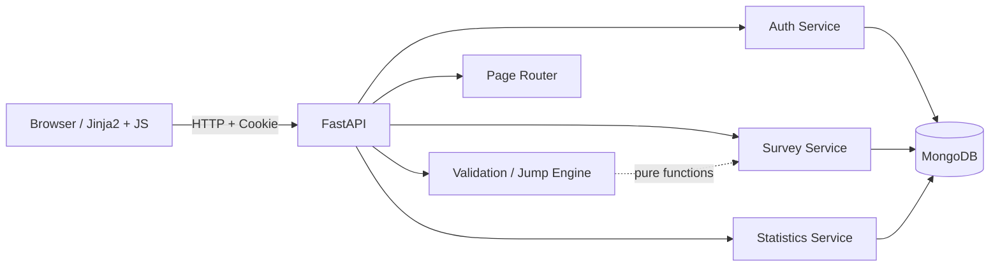

# 项目完成报告：问研 Survey Studio

## 1. 项目概述

本项目实现了一个简化版在线问卷系统，支持用户注册登录、创建与管理问卷、
四种题型、数据驱动的条件跳转、公开链接填写、匿名提交和自动统计。
后端使用 FastAPI + Pydantic v2 + PyMongo，所有业务数据存储在 MongoDB 中；
前端使用 Jinja2 + 原生 JavaScript，FastAPI 同时提供页面和 JSON API。

第一阶段目标是形成一个**可运行、可演示、可测试**的完整系统，并为第二阶段
需求变化保留版本和数据结构的演进空间。


## 2. 需求完成情况

| 需求 | 实现 |
|---|---|
| 用户注册、登录 | 用户名/邮箱注册，Argon2id 哈希，JWT + HttpOnly Cookie / Bearer |
| 查看自己的问卷 | `GET /api/surveys` 按 `owner_id` 过滤 |
| 创建问卷 | 标题、说明、匿名、多次填写、截止时间；生成唯一 Slug |
| 发布、关闭、截止时间 | 发布冻结版本；关闭后拒绝提交；可修改截止时间 |
| 公开填写链接 | `/survey/{slug}` 页面和 `/api/public/surveys/{slug}` |
| 单选题 | 选项、必答、服务端选项合法性校验 |
| 多选题 | 最少、最多、指定数量；重复/未知选项拒绝 |
| 文本填空 | 最短/最长字数、可选去除首尾空白 |
| 数字填空 | 可配置是否必须整数；支持安全整数或有限小数，闭区间最小/最大值 |
| 数据驱动跳转 | `logic.rules` + 条件组 + 运算符注册表；不使用问卷专属硬编码 |
| 顺序填写和自动跳转 | 服务端 `/next` 逐步返回下一题；最终提交重新重放路径 |
| 错误提示 | 稳定错误码，例如 `selection_count`、`number_out_of_range` |
| 每次提交保存 | 一份答卷一个文档，单文档原子插入 |
| 多人同时填写 | 提交路径无共享热文档；已通过 30 个并发匿名提交测试 |
| 匿名填写 | 匿名时 `respondent_id=null`，不保存 IP/UA |
| 同一个人多次填写 | 问卷级 `allow_multiple_responses` 配置 |
| 已发布问卷继续演进 | 从已发布版本克隆新草稿，发布 v2，旧版本和旧答卷保留 |
| 发布后运营调整 | 截止时间、匿名策略、多次填写策略可在工作台修改 |
| 统计 | 整卷总览、单题详情、选项频次、作答人数、数字均值/最值、文本分页 |
| 第二阶段兼容 | 问卷内容版本化，答卷固定引用版本；旧版本保留 |

## 3. 系统设计



主要模块：

- `backend/auth/`：注册、登录、当前用户、密码与 JWT。
- `backend/surveys/`：问卷生命周期的管理端 API、公开填写 API、草稿保存、提交。
- `schemas/pydantic/`：领域模型、校验函数、跳转决策、整卷路径重放。
- `backend/stats/`：统计聚合管道、结果映射和统计 API。
- `backend/web.py` + `templates/` + `static/`：页面和交互。
- `backend/database.py`、`backend/init_db.py`：索引初始化。

安全边界：

- 管理接口要求登录且校验 `owner_id`；
- 公开页面只暴露问卷标题、说明和逐题内容，不暴露所有者信息；
- 要求登录的问卷在公开填写 API 中返回 401；
- 所有答案由服务端重新校验，隐藏分支答案会被拒绝；
- Cookie 使用 `HttpOnly`、`SameSite=Lax`；生产环境可设置 `Secure`。

运行方式采用单机 MongoDB，不强制 Docker 或副本集。发布流程设计为幂等操作，
避免依赖事务；事件处理仍可重复执行和恢复。

## 4. MongoDB 设计

详细设计见 [README 的数据库设计章节](../README.md#数据库设计)；与需求相关的核心决策：

1. `users`、`surveys`、`survey_versions`、`responses` 分开，避免单集合混杂。
2. 题目、选项、校验规则和跳转规则内嵌在不可变 `survey_versions` 快照中。
3. 一份提交对应一个 `responses` 文档，答案数组内嵌；避免无限增长和 16 MB 限制。
4. 发布后的版本不修改；答卷固定引用 `survey_version_id`。
5. `slug`、用户名、邮箱、提交 token、版本号等由唯一索引兜底。
6. 统计按当前已发布版本执行，避免不同版本定义混算。

主要索引：

```text
users: username unique; email unique
surveys: slug unique; owner_id + created_at; status + closes_at
survey_versions: survey_id + version_no unique; survey_id + state
responses: survey_id + submission_token unique
responses: survey_id + submitted_at
responses: survey_id + survey_version_id + submitted_at
responses: survey_id + survey_version_id + answers.question_id
```

## 5. 跳转设计

跳转规则存储在版本内的题目对象中，结构为：

```json
{
  "fallback": { "action": "next" },
  "rules": [
    {
      "rule_id": "r_skip_0001",
      "when": {
        "mode": "all",
        "conditions": [
          {
            "question_id": "q_gate_0001",
            "operator": "eq",
            "value": "o_no_00000001"
          }
        ]
      },
      "then": {
        "action": "goto",
        "target_question_id": "q_text_0004"
      }
    }
  ]
}
```

- 规则按顺序匹配，第一条命中生效；
- 条件支持 `all`、`any`；
- 单选支持 eq/neq/in/not_in；
- 多选支持包含/不包含、集合相等和选择数量比较；
- 数字支持比较和闭区间；
- 只允许向后跳转，发布时校验目标存在且不形成环；
- 浏览器通过 `/next` 获取下一题，最终提交由服务端重新计算完整路径。

这一设计让问卷逻辑完全由数据驱动，而不是每个问卷写一段后端分支代码。

## 6. 校验设计

校验分三层：

1. **请求结构校验**：Pydantic 模型和字段长度/类型约束；
2. **发布语义校验**：题目 ID/选项 ID 唯一、跳转目标、运算符和约束匹配；
3. **提交校验**：按冻结版本验证每个可见答案、必答关系和最终路径。

关键错误码：

```text
required
unknown_option
selection_count
empty_text
text_too_short
text_too_long
number_not_integer
number_out_of_range
unsupported_operator
answer_context_missing
```

多选总作答人数和选项频次分开统计；数字题边界是闭区间；文本按 Unicode 码点统计长度。

## 7. 前端设计

前端为无构建依赖的 Jinja2 + 原生 JavaScript：

- 登录/注册：Cookie 登录，支持 `next` 回跳；
- 工作台：问卷列表、创建、复制链接、关闭、进入编辑/统计；
- 编辑器：四种题型、选项、校验、排序、整份草稿保存、发布、
  可视化添加跳转规则；
- 填写页：逐题展示，服务端计算下一题，选答题可跳过，匿名选择；
- 统计页：指标卡、CSS 横条图、数字统计、文本答案分页。

这种方案避免了额外 Node.js 构建依赖，也满足课程“前端可非常简单”的要求。
页面已经用实际浏览器完成“注册 → 创建 → 编辑 → 发布 → 填写 → 统计”的冒烟验证。

## 8. 测试结果

自动化测试使用 pytest + requests + 真实 Uvicorn + 临时单机 MongoDB：

```text
python -m pytest -v
64 passed
```

覆盖范围：

- 数据库 Schema、统计映射、跳转与校验单元测试；
- 注册、登录、登出、用户名/邮箱唯一性、Bearer 和 Cookie；
- 问卷创建、题目添加、整份草稿保存和 revision 冲突；
- 权限隔离：他人不能查看、修改、发布自己的问卷；
- 问卷发布幂等、关闭后禁止提交、一次性提交限制；
- 六类必测场景：创建、加题、跳转、校验、正常/匿名提交、统计；
- 公开 Slug 访问、服务端分支计算、选答题跳过；
- 30 个并发匿名提交后统计数量准确；
- 页面渲染与静态资源访问。

详细步骤、输入和实际结果见 [系统测试用例](system-test-cases.md)。

## 9. 遇到的问题与解决方案

| 问题 | 解决方案 |
|---|---|
| 初始设计容易把答卷内嵌到问卷 | 改为一份答卷一个文档，避免 16 MB 和写热点 |
| 跳转函数返回单纯 `None` 语义不明确 | 使用 `JumpDecision(goto/next/end)`，完整路径重放 |
| 多选规则跨层重复 | 收敛为 `validate_answer` 纯函数，Pydantic/Mongoose 只负责结构 |
| 统计空数据没有明确口径 | 选项补零，数字平均值返回 null，明确作答人数 |
| 真实认证缺失，测试靠伪造身份 | 增加真实注册登录、JWT、Cookie；测试改用真实账号 |
| Docker/副本集可能提高运行门槛 | 发布采用幂等两阶段写入，不强制事务；单机可运行 |
| 前端可能与服务端跳转逻辑重复 | 增加 `/next` 接口，由服务端计算下一题 |
| 初次测试只验证了正常流程 | 增加无效答卷不落库、权限、关闭、并发等断言 |

## 10. AI 使用过程

AI 使用日志、初始方案、发现的问题和人工修改见 [AI 使用日志](ai-usage-log.md)。
本报告和代码中的最终决策均以实际运行结果和测试为依据；AI 生成的代码经过人工审查、
补充约束和回归测试后才进入项目。

## 11. 第二阶段兼容性

- `survey_versions` 内容不可变，`responses` 固定引用版本；
- 新增题型、操作符或展示字段可做加法，不重写旧答卷；
- 已发布版本内容不可直接覆盖；通过“创建新版本草稿 → 发布 v2”扩展，旧版本和旧答卷保留；
- 新增协作、审计、文件题等应通过新集合和新的答案类型扩展；
- 统计按版本计算，新增统计维度不需要迁移旧问卷；
- 不依赖副本集事务，部署方式不会限制旧数据保留。

## 12. 运行与配置

见 [README 快速开始](../README.md#快速开始) 和 [API 说明](api.md)。
