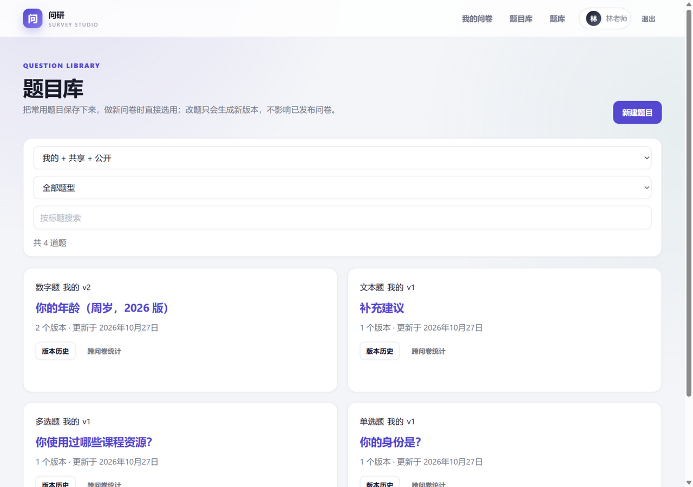
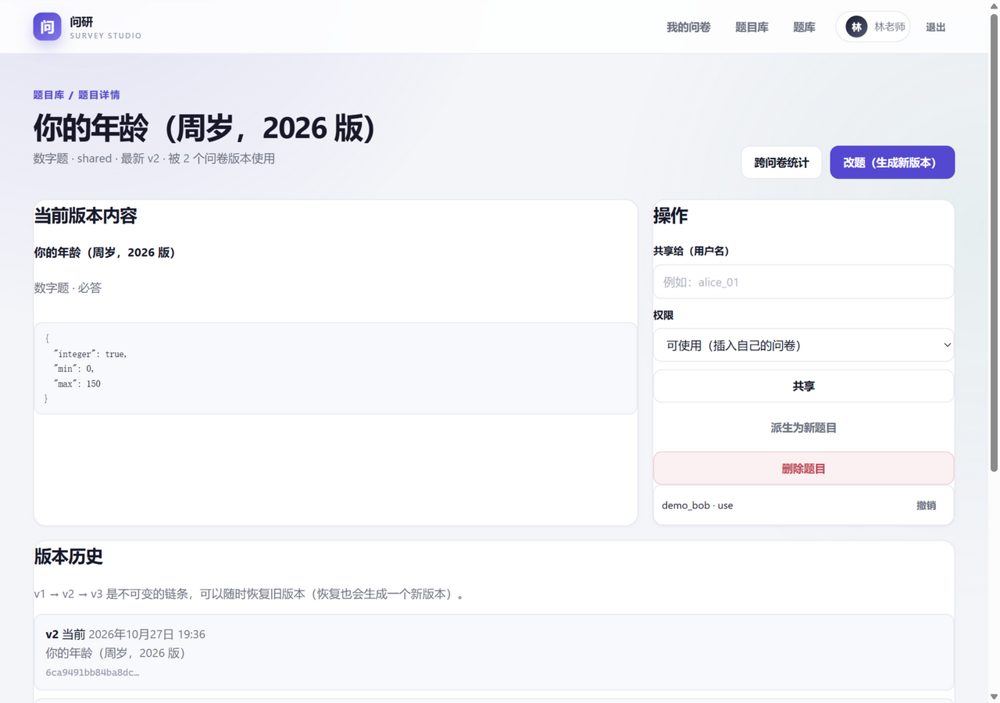
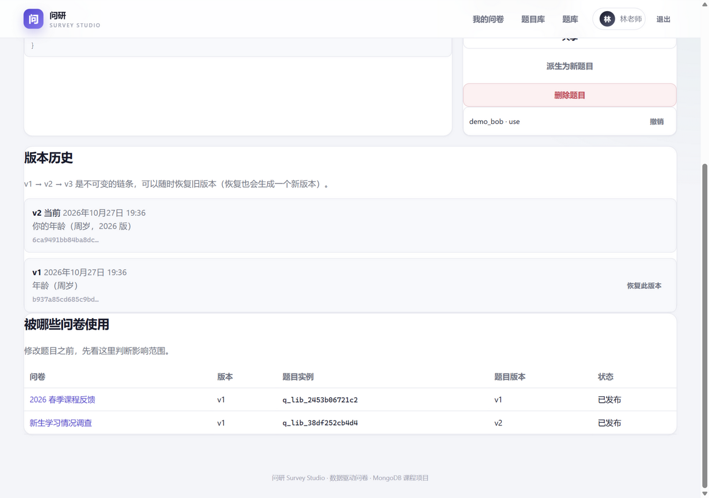
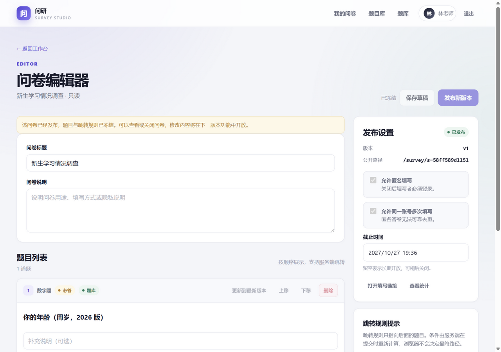
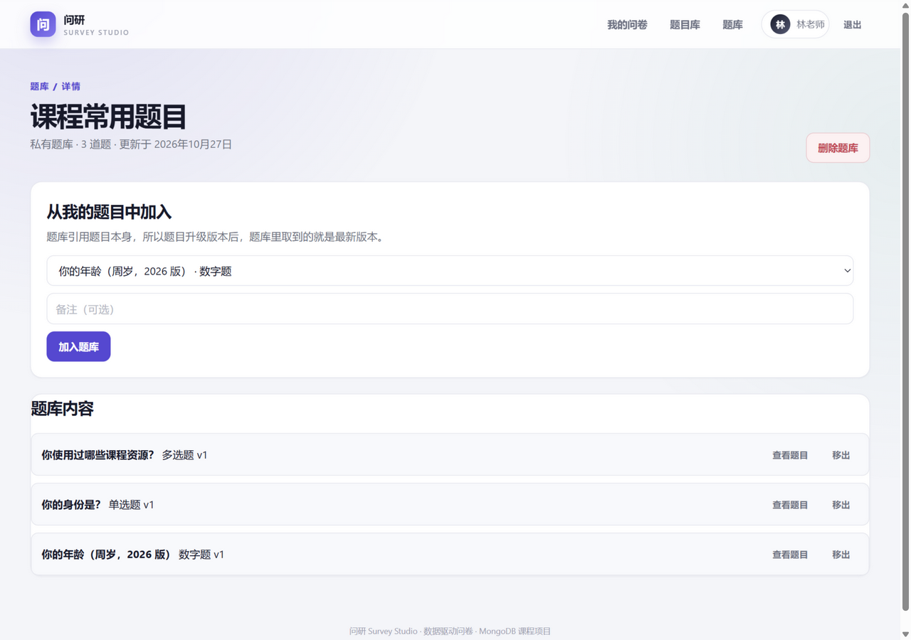
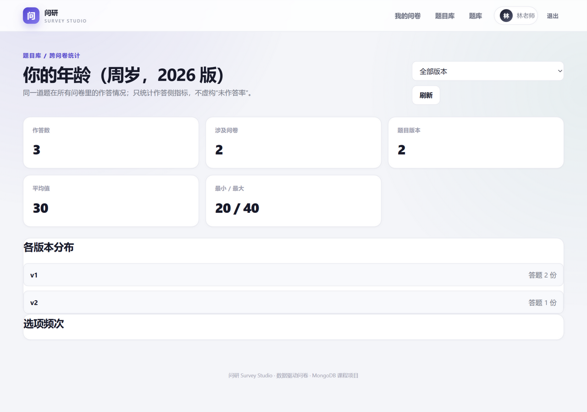

# 项目完成报告：问研 Survey Studio（第二阶段）

# 摘要

本报告说明在线问卷系统“问研 Survey Studio”如何在第一阶段成果上完成第二阶段需求变更，而不是另起一套系统。第一阶段以不可变问卷版本、内嵌题目与跳转规则、单文档答卷和 MongoDB 聚合统计为核心；第二阶段把题目拆成可复用、可共享、可版本化的独立实体，在问卷版本中保留冻结快照和题目引用，在答案中写入题目版本引用，从而支持题目库、题库、反向查询和跨问卷统计。

本次复核采用代码审计、API 行为、真实浏览器截图和自动化测试四类证据，不以文档声明作为完成依据。复核结果为：8 条新增需求全部落地；全量测试 130 个通过，其中第一阶段 64 个用例的断言未改动，第二阶段新增 66 个；迁移校验 27 项断言 0 失败；新增页面与关键交互均已用真实数据走通。报告同时说明修改原因、数据结构变化、兼容性处理、AI 使用过程和仍然存在的边界。

关键词：MongoDB；文档模型；版本化；题目复用；跨问卷统计；FastAPI

# 1. 项目概述

本系统实现了一个简化版在线问卷系统：注册登录、创建与管理问卷、四种题型、数据驱动的条件跳转、公开链接填写、匿名提交、单卷统计，以及第二阶段的题目库、共享、题库和跨问卷统计。后端使用 FastAPI + Pydantic v2 + PyMongo，所有业务数据只写入 MongoDB；前端使用 Jinja2 + 原生 JavaScript，不依赖 Node.js 构建流程。

第二阶段的目标不是“增加几个页面”，而是在原有模型上回答一个结构性问题：当同一道题要被多份问卷复用时，题目应该以什么身份存在。系统最终采用“引用 + 冻结快照”的混合方案：问卷版本仍然保存完整的题目内容，保证展示、校验和单卷统计一次读取即可完成；同时题目在独立集合中有稳定身份和不可变版本，问卷和答案通过 `question_ref` 指向它。这样既保留了第一阶段的读路径结论，又获得了跨问卷能力。

**表 1 技术组成**

| 层次 | 技术 | 说明 |
|---|---|---|
| 后端 | FastAPI + Pydantic v2 | 路由、请求校验、OpenAPI 文档 |
| 数据库 | MongoDB 8.3 + PyMongo | 唯一业务数据存储，单机即可运行 |
| 前端 | Jinja2 + 原生 JavaScript | 无构建步骤，后端直接渲染 |
| 认证 | Argon2id + JWT | HttpOnly Cookie / Bearer Token |
| 测试 | pytest + requests + 真实 Uvicorn | 隔离 MongoDB + HTTP 服务 |

# 2. 需求变更与完成度

第二阶段的需求变更文档提出 8 条用户诉求：保存常用题、共享题目、改题不影响旧问卷、查看修改历史并恢复、同一题不同版本并存、反查题目被哪些问卷使用、建立题库、查看单题跨问卷统计。前 7 条围绕“题目身份”，第 8 条围绕“答案身份”；它们共同把题目从问卷内部字符串提升为跨问卷资产。

## 2.1 八条需求与处理方式

**表 2 第二阶段八条需求与处理方式**

| 编号 | 用户诉求 | 处理方式 |
|---|---|---|
| R1 | 保存常用题目，做新问卷时直接选用 | 新增 `questions` 与 `question_versions`；问卷版本增加“从题库插入”入口 |
| R2 | 把题目共享给同事使用 | 新增 `question_shares`，以 owner / shared / public 三级可见性控制 |
| R3 | 改题目不影响已经做好的问卷 | 改题只生成新版本；问卷钉住引用时的 `version_id`，保存和发布时校验快照哈希 |
| R4 | 记录修改历史、能恢复旧版本 | `parent_version_id` 构成不可变版本链；恢复旧版本会生成一个新版本 |
| R5 | 同一题目的不同版本可以同时存在 | 问卷题目带 `question_ref.version_id`，不同问卷可钉住不同版本 |
| R6 | 查看某个题被哪些问卷使用 | `questions.question_ref.entity_id` 多键索引 + 反向查询接口 |
| R7 | 建立题目库（题库） | 新增 `question_libraries` 与 `question_library_items`，条目引用题目实体 |
| R8 | 查看单个题目跨问卷的统计 | 答案写入 `question_ref`；新增跨问卷聚合管道与统计页面 |

## 2.2 完成度与证据矩阵

完成度按“可复核证据”判断：接口存在不算完成，必须有数据、测试或页面证据。下表把 8 条需求分别对应到实现落点、可复核证据和状态。

**表 3 第二阶段完成度与证据矩阵**

| 需求 | 实现落点 | 可复核证据 | 状态 |
|---|---|---|---|
| R1 复用 | `questions`、`question_versions`、`POST /surveys/{id}/questions/from-library` | `/questions` 页面；Q-01、V-01 | 完成 |
| R2 共享 | `question_shares`、共享/撤销接口、`scope=shared/public` | S-01 至 S-07 | 完成 |
| R3 旧卷保护 | 版本只追加；问卷钉住 `version_id`；快照哈希校验 | Q-03、V-03 | 完成 |
| R4 历史恢复 | `parent_version_id`、`restored_from_version_id`、恢复接口 | Q-04、Q-07；版本历史截图 | 完成 |
| R5 多版本 | `question_ref.version_id`、草稿升级到最新版本接口 | V-04、C-02 | 完成 |
| R6 反查 | 多键索引、`/api/questions/{id}/usages` | S-07；版本历史截图 | 完成 |
| R7 题库 | `question_libraries`、`question_library_items`、题库 API 与页面 | L-01 至 L-09；题库详情截图 | 完成 |
| R8 跨卷统计 | `answers[].question_ref`、`backend/stats/cross.py`、统计页面 | C-01 至 C-08；跨问卷统计截图 | 完成 |

## 2.3 复核口径

本轮复核在 2026-10-27 执行，使用四类证据交叉验证：

| 证据类型 | 复核对象 | 本轮结果 |
|---|---|---|
| 代码结构 | Pydantic、JSON Schema、Mongoose 三套模型是否描述同一份题目内容 | 三套模型均通过脚本校验，内容哈希一致 |
| API 行为 | 题目、版本、共享、题库、问卷引用、跨问卷统计 | 21 个新增题目/题库路径全部有自动化用例覆盖 |
| 数据迁移 | 第一阶段形态的问卷、答案与坏数据 | 27 项一致性断言 0 失败；第二次执行幂等 |
| 真实界面 | 题目库、题目详情、版本历史、编辑器、题库、跨问卷统计 | 6 张真实浏览器截图，见第 9 章 |

# 3. 变更记录（老师要求必须说明的八个问题）

## 3.1 第一阶段的设计是什么

第一阶段有 4 个核心集合加 1 个可选统计投影：`users`、`surveys`、`survey_versions`、`responses`、`survey_stat_snapshots`。关键决策是：**题目与跳转规则内嵌在不可变的 `survey_versions` 快照中**，`question_id` 是版本内部字符串（如 `q_single_0001`）；一份答卷一个文档，答案数组内嵌。这样展示、校验、统计都只需读取一个版本文档，没有 N+1 查询。

## 3.2 新需求带来了哪些问题

需求 R1、R2、R4、R5、R6、R7、R8 都要求“同一道题跨问卷存在”，而内嵌模型里题目没有身份：`question_id` 离开那一版问卷就没有意义。于是：

- 无法复用：每份问卷都是独立副本，没有“这道题”这个概念；
- 无法共享：权限模型只有“问卷属于某个 owner”；
- 无法反向查询：只能问卷到题目，不能从题目反查问卷；
- 无法跨问卷统计：答案只认版本内字符串 ID，跨问卷无法归并；
- 无法表达“不同问卷用不同版本”：一份问卷只有一个题目副本；
- 需求 R3 的抱怨在内嵌模型里其实已经是冻结的，真正的问题是共享题目落地后，一道题会同时被多份问卷引用，必须有版本边界。

## 3.3 为什么需要修改原设计

原设计的正确性建立在“题目只属于一份问卷”上。需求变更把题目变成了跨问卷共享的资产，内嵌模型无法表达“同一身份、多处使用、各自钉住版本”。这是模型层面的矛盾，不是加一个字段能解决的。

但也不需要推倒重来：只需要给题目补一个身份层，问卷侧继续保留内容快照。这样第一阶段已经验证过的读路径、校验路径和统计路径都能继续使用。

## 3.4 修改了哪些部分

**表 4 第二阶段改动范围**

| 部分 | 改动 |
|---|---|
| 集合 | 新增 5 个：`questions`、`question_versions`、`question_shares`、`question_libraries`、`question_library_items` |
| 问卷版本 | 题目对象新增可选 `question_ref`；`content_schema_version` 允许 1 或 2 |
| 答卷 | 答案新增可选 `question_ref` |
| 模型 | Pydantic 新增 `QuestionContent` 判别联合、`QuestionRef` 与 5 个文档模型；JSON Schema、Mongoose 同步补齐 |
| 后端 | 新增 `backend/questions/`（服务、路由、题库路由）；新增 `backend/stats/cross.py`；问卷服务增加 3 个入口与 2 处校验 |
| 前端 | 新增 5 个页面与 7 个 JavaScript 文件；编辑器接入“从题库插入”和“更新到最新版本” |
| 脚本 | 新增迁移、回填、迁移校验三个脚本，并扩展三套模型的一致性校验 |
| 测试 | 新增 66 个用例，原 64 个用例的断言一个未改 |

**没有修改的部分**（“不得推倒重做”的直接证据）：

- 跳转引擎：`schemas/pydantic/jump.py`、`engine.py`、`validate_response` 的跳转与校验逻辑未改；
- 单卷统计管道：`backend/stats/pipelines.py` 的 5 个 `$facet` 分支未改；
- 发布冻结、幂等发布、单文档提交、并发填写：结构未改，只在校验里增加题目引用检查；
- 认证、权限隔离、Cookie/JWT：未改；
- 旧字段：`answers[].question_id`、`survey_versions.questions[].question_id`、`logic` 结构均未改。

## 3.5 数据结构如何变化

**新增身份层，内容仍以内嵌快照为准**：

```text
questions（身份，可变）
  _id, owner_id, root_entity_id, source_entity_id, source_version_id,
  lineage_depth, type, title, visibility,
  latest_version_id, latest_version_no, version_count, deleted_at

question_versions（内容，不可变）
  _id, entity_id, version_no, parent_version_id, restored_from_version_id,
  content { type, title, description, required, options, validation },
  content_hash, created_by, created_at, legacy_key

question_shares
  entity_id, grantee_id, permission(view|use), granted_by, created_at

question_libraries / question_library_items
  题库元数据 / 条目（引用题目实体，不是版本）
```

改造后的问卷题目与答案都是纯加法：

```json
{
  "question_id": "q_single_0001",
  "type": "single_choice",
  "title": "你的身份是？",
  "required": true,
  "options": [{ "option_id": "o_opt_00000000", "label": "学生" }],
  "logic": { "fallback": { "action": "next" }, "rules": [] },
  "question_ref": { "entity_id": "66f2...", "version_id": "66f2..." }
}
```

`question_ref` 缺失即第一阶段遗留题目，行为与旧版完全一致。这个可选字段是兼容策略的核心：新代码能读旧文档，旧请求体也不需要改。

## 3.6 程序如何调整

- **新增服务层** `backend/questions/service.py`：题目 CRUD、版本派生、恢复、fork、共享、反向查询、题库管理，以及供问卷服务调用的“按版本解析题目”接口；
- **问卷服务三处扩展**：`add_question_from_library`（从题库插入）、`refresh_question_version`（草稿升级到最新版本）、`_check_question_refs`（校验 I2/I3）；
- **发布与提交**：发布前重算快照哈希并与所引题目版本比对；提交时由服务端写入答案的 `question_ref`，客户端传来的引用会被丢弃（不变式 I4）；
- **统计**：新增 `backend/stats/cross.py`，以 `answers.question_ref.entity_id` 为入口做跨问卷聚合；
- **前端**：5 个新页面 + 编辑器两个入口，全部调用同一套 JSON API。

## 3.7 是否遇到兼容性问题

遇到四类问题，都在设计阶段处理：

**表 5 兼容性问题与处理**

| 问题 | 处理 |
|---|---|
| 旧文档无 `question_ref` | 字段设为可选，缺失即“纯内嵌题目” |
| 旧答卷无引用 | 迁移脚本回填；回填前旧数据不参与跨问卷统计 |
| `question_id` 两处含义不同 | 约定：问卷内是实例 ID，题目库用 `entity_id` |
| ObjectId 的 JSON 类型 | 模型层用 `BeforeValidator` 兼容，持久化转回 ObjectId |

兼容性不是靠声明，而是有可执行测试。新增的 5 个兼容性用例直接构造第一阶段形态的文档与请求体，验证读取、发布、提交和单卷统计仍然正常。

**表 6 兼容性测试证据**

| 用例 | 验证内容 | 结果 |
|---|---|---|
| 旧题目请求体 | 不含 `question_ref` 时仍可保存 | 通过 |
| 旧版本文档 | `content_schema_version=1` 时仍可读 | 通过 |
| 混合问卷 | 题库题与手写题可发布、可提交 | 通过 |
| 旧草稿请求体 | 保存行为不变 | 通过 |
| 旧答卷统计 | 无 `question_ref` 的答卷可正常统计 | 通过 |

## 3.8 如何保证旧功能仍然可用

不是靠声明，是靠可执行的证据：

1. **第一阶段 64 个测试用例一个断言都没改，全部通过**；
2. 新增 5 个兼容性测试，直接构造第一阶段形态的文档（`content_schema_version=1`、无引用、无 `question_ref` 的答卷），验证读取、发布、提交、单卷统计仍然正常；
3. 迁移脚本对无法解析的旧题目**跳过而不是删除**，有专门用例断言原内容原样保留；
4. 迁移前后 27 项一致性断言（`scripts/verify_migration.py`）全部通过。

# 4. MongoDB 设计论证

## 4.1 为什么适合 MongoDB，而不是关系数据库

问卷的核心读取单位是“一份问卷的一个版本”：题目、选项、校验和跳转规则需要一起读、一起校验、一起展示。关系数据库当然可以建模，但需要题目表、选项表、校验表、跳转规则表、答案表、答案选项表，读取一份问卷要多次连接；四类题型的 `validation` 还会退化成宽表或 EAV。文档模型把这一整块内容放在一个版本文档里，读路径天然是一次读取。

**表 7 关系模型与文档模型的差异**

| 维度 | 关系数据库的典型做法 | 本系统的文档模型 |
|---|---|---|
| 四种题型的差异字段 | 宽表或 EAV，查询与校验复杂 | `QuestionContent` 判别联合，按题型校验 |
| 读取一份问卷 | 多次 join 拼装题目与选项 | 读一个 `survey_versions` 文档 |
| 版本历史 | `UPDATE` 历史行或额外版本表 | 追加新文档，旧文档不可变 |
| 一次答卷提交 | 主表 + 答案子表 + 选项子表，多表写入 | 一个 `responses` 文档，单文档原子写 |
| 跨问卷统计 | 多表 join 后 group | 多键索引 + `$unwind` + `$facet` |

## 4.2 引用与冗余的平衡

“引用 + 冻结快照”意味着同一份内容存两处。允许它存在的前提是三条规则：

1. 引用题的快照内容必须与所引版本哈希一致（I2）；
2. 改内容只能生成新版本或 fork，不能就地改快照；
3. 发布时重算哈希，不一致直接拒绝发布。

这样做的收益是：读路径保持“一次读取版本即可展示、校验、统计”，同时获得跨问卷身份。如果改成纯引用，每次读问卷都要按版本拼装题目，退化为 N+1；如果坚持纯内嵌，又无法复用。混合方案是这两个极端之间的可验证折中。

## 4.3 索引设计

第二阶段新增 17 个索引，其中四条多键索引支撑两个新查询：

```text
survey_versions: { questions.question_ref.entity_id: 1 }
  # 反向查询：这道题被谁用了
survey_versions: { questions.question_ref.version_id: 1 }
  # 版本级使用
responses:       { answers.question_ref.entity_id: 1, submitted_at: -1 }
  # 跨问卷统计
responses:       { answers.question_ref.version_id: 1 }
```

跨问卷统计的管道先用多键索引缩小文档集，再 `$unwind` 并在数组内精确过滤，最后用 `$facet` 同时计算数字统计、选项频次和文本分页。这与第一阶段的 `_question_prefilter` 是同一个套路，避免全表扫描。

## 4.4 六条不变式

**表 8 六条不变式与强制位置**

| 编号 | 不变式 | 强制位置 |
|---|---|---|
| I1 | 题目版本只插入不更新 | 版本服务只允许创建新版本；历史版本内容不可变 |
| I2 | 问卷中的快照必须等于所引题目版本 | 草稿保存、发布前重算 `content_hash` 并比对 |
| I3 | 同一问卷内不重复引用同一题目实体 | 插入、刷新、保存时检查 `entity_id` 唯一 |
| I4 | 答案引用必须等于问卷钉住的版本 | 提交时由服务端写入，忽略客户端引用 |
| I5 | 被已发布问卷引用的题目不能硬删 | 删除前检查使用情况，返回 409 |
| I6 | 同一题目内 `option_id` 跨版本稳定 | 新版本按已有 ID 或 label 继承选项 ID |

I6 是跨版本统计能按 `option_id` 合并的前提。**改选项文字视为“旧选项删除 + 新选项新增”**，这一点在设计和测试里都写明了；否则一次改字就会让历史统计断裂。

## 4.5 16 MB 与宽表风险

MongoDB 的单文档上限是 16 MB。本系统通过结构约束避免触顶：

- 问卷版本中的题目数量受问卷业务规模限制，题目内容只是标题、选项和少量校验字段；一份问卷版本通常远小于 1 MB；
- 版本不可变，不会在一个文档里无限追加历史；历史在 `question_versions` 中独立成文档；
- 一份答卷一个文档，答案数组大小由题目数量决定，不随时间增长；
- 题目身份与内容分离，`questions` 只保存指针和统计字段，不会因版本历史变宽；
- 跨问卷统计通过索引和聚合完成，不建立物化宽表。

# 5. 跳转设计（未改动）

跳转规则仍存储在每个问卷版本的题目对象里，结构、运算符、服务端重放逻辑完全不变。第二阶段只做了一件事：题目从题库插入时，`logic` 由插入接口的 `logic` 参数给出（默认空），之后仍由编辑器与发布校验管理。跳转与“题目身份”无关，这是它能完全不用改的原因。

跳转引擎的 23 个单元测试覆盖单选 eq、多选 includes_all、数字比较、all/any 条件组、首个匹配规则、fallback、end、自定义运算符等路径。第二阶段新增的题目引用没有改变这些语义。

# 6. 校验设计

校验分三层，第二阶段只加了两条跨文档规则：

**表 9 三层校验**

| 层 | 内容 |
|---|---|
| 请求结构 | Pydantic 模型；新增 `QuestionContent` 判别联合与 `QuestionVersion` 模型 |
| 发布语义 | 原有题目 ID/跳转图校验 + 快照哈希必须等于所引版本 + 同问卷不重复引用 |
| 提交 | 原有路径重放与答案校验 + 答案引用由服务端写入 |

新增稳定错误语义：题型改变未 fork 返回 422；快照与版本不一致返回 422；被已发布问卷引用的题目删除返回 409；同问卷重复引用返回 409。客户端无法通过伪造 `question_ref` 绕过校验，因为提交路径会重新计算实际展示过的题目，并由服务端写入引用。

# 7. 跨问卷统计口径

跨问卷统计以 `question_ref.entity_id` 为入口，输出以下指标：

**表 10 跨问卷统计指标**

| 指标 | 含义 | 说明 |
|---|---|---|
| `answered_count` | 该题实际作答份数 | 只统计有答案的记录 |
| `survey_count` | 涉及问卷数 | 按问卷去重 |
| `version_count` | 涉及题目版本数 | 用于观察版本分布 |
| 选项频次 | 被选择次数 | 默认按 `option_id` 跨版本合并 |
| 数字统计 | 平均值、最小值、最大值 | 只对数字题计算 |
| 文本回答 | 文本与来源问卷分页 | 按提交时间稳定排序 |
| `option_set_mismatch` | 选项集是否跨版本一致 | 标注选项出现的版本 |

统计**不报告“未作答率/覆盖率”**：跳转会让某题根本没被展示，而“没展示”和“跳过”在数据上不可区分，硬算会得出误导性结论。这个取舍写进了接口说明和测试。

演示库中的数字题统计为 3 份答卷、2 份问卷、均值 30、最小值 20、最大值 40，与第 9 章截图一致。

# 8. 迁移过程与结果

第一阶段不存在共享，所以迁移按“每个（问卷版本, 题目）各自成为独立实体”处理，不做跨问卷合并。合并需要猜测意图，宁可保守。迁移是纯加法、可重复执行：

**表 11 迁移脚本**

| 脚本 | 作用 | 幂等性 |
|---|---|---|
| `scripts/migrate_phase2.py` | 为旧题目创建实体与版本，回写 `question_ref` | `legacy_key` 去重；第二次执行 `created=0` |
| `scripts/backfill_response_refs.py` | 为旧答卷答案回填题目引用 | 只处理缺失引用的答案 |
| `scripts/verify_migration.py` | 校验快照内容、引用、哈希与统计一致性 | 只读，可重复执行 |

```text
迁移前：survey_versions 2 条，内嵌题目 6 道，答卷 2 份
--dry-run ：entities created 6, refs written 6
第一次执行：created 6, refs written 6
第二次执行：already had a ref 6, created 0, refs written 0   ← 幂等
回填答卷  ：responses updated 2, answers updated 3, unmapped 0
迁移校验  ：assertions 27, failures 0
```

完整输出见 `docs/第二阶段/migration-*.txt` 与 `backfill-run.txt`。迁移不删除任何旧内容；无法解析的旧题目会被跳过并保留原样，有专门测试覆盖。`verify_migration.py` 需指向已完成迁移的数据库；在空库上运行会因无数据而失败，这不是迁移校验本身的失败。

# 9. 界面证据

以下截图来自 2026-10-27 的临时演示库，使用真实浏览器会话和真实 MongoDB 数据：4 道题、2 份问卷、3 份数字题答卷，演示账号为 `demo_alice`。截图文件保存在 `docs/screenshots/`，可在 Word 报告和仓库中直接查看。

## 9.1 题目库列表

题目库列表展示题目类型、版本数、更新时间和“版本历史/跨问卷统计”入口。右上角的“新建题目”是题目资产的创建入口，而不是创建问卷题目。



## 9.2 题目详情与共享

题目详情页展示当前版本内容、共享对象、权限、派生和删除操作。被共享者只获得 `use` 权限，不能改题；删除按钮对已发布问卷引用的题目会被服务端拒绝（I5）。



## 9.3 版本历史与反向引用

同一页面的下半部分把“版本历史”和“被哪些问卷使用”放在一起。版本链按 `v1 → v2` 展示，旧版本可以恢复；使用列表显示问卷标题、问卷版本、题目实例、题目版本和发布状态。这是 R4 与 R6 的界面证据。



## 9.4 编辑器中的题库集成

编辑器中的题库题带“题库”标记，并提供“更新到最新版本”。已发布问卷处于只读状态，题目内容和跳转规则被冻结；修改需要发布新版本。这个页面同时验证了“从题库插入”和“版本升级”两个入口。



## 9.5 题库详情

题库详情页展示题库条目、备注和题库操作。题库条目引用题目实体而不是固定版本，因此题目升级后，从题库取到的是最新版本；题目本身仍可独立维护。



## 9.6 跨问卷统计

跨问卷统计页按题目实体聚合，展示作答数、涉及问卷、题目版本、均值/最值、版本分布和选项频次。演示数据为 3 份答卷、2 份问卷、均值 30、最小值 20、最大值 40。



# 10. AI 使用过程

完整 Prompt、Result、Modify 记录见 [AI 使用日志](ai-usage-log.md) 的 P-01 至 P-08。工具为 DeepSeek（通过 Zcode）。概括如下：

**表 12 AI 帮助、错误与人工修改**

| 维度 | 内容 |
|---|---|
| AI 帮了什么 | 生成三套模型的字段骨架、批量 CRUD 路由、前端表单与页面骨架、迁移脚本初稿、测试脚手架；大约节省一半打字量 |
| AI 做错了什么 | 第一版方案是“每题一份文档 + 全引用”，会破坏第一阶段读路径并迫使旧数据重写；迁移脚本把 `InsertOne` 直接传给 `insert_many`；跨问卷统计初稿异步 `aggregate` 用法错误；选项 ID 按位置生成会让跨版本统计错位；搜索接口未转义 `$regex` |
| 自己改了什么 | 改为“引用 + 冻结快照”；把选项 ID 改为按已有 ID 或 label 继承；增加哈希一致性校验；设计迁移幂等键与坏数据跳过策略；决定不报告“未作答率” |
| 自己设计了什么 | 六条不变式及其强制位置、三套模型的内容哈希交叉验证、`question_ref` 的“实例 ID / 实体 ID”命名约定、跨问卷统计的版本筛选语义 |

AI 在这个项目里主要用于扩大产出，不负责最终判断。凡是影响数据一致性、旧数据兼容和统计口径的决定，都经过人工重新设计并用测试锁定。

# 11. 测试结果

## 11.1 执行结果

```text
python -m pytest -q                    →  130 passed, 1 third-party warning
python scripts/verify_jsonschema.py    →  All 13 examples passed
python scripts/verify_mongoose.js      →  Mongoose schema checks passed
python scripts/verify_pydantic.py      →  Pydantic + engine checks passed
python scripts/verify_migration.py     →  MIGRATION VERIFICATION PASSED（27 项断言）
```

1 条告警来自第三方 Starlette/httpx 的弃用提示，不影响测试结果。完整输出见 `docs/第二阶段/pytest.txt` 和 `docs/第二阶段/schema-validation.txt`。迁移校验的 27 项断言来自迁移数据集；本轮另对演示数据库运行同一脚本，得到 26 项断言、0 失败。

## 11.2 测试分布

**表 13 全量测试分布**

| 阶段 | 文件 | 用例数 | 覆盖 |
|---|---|---:|---|
| 第一阶段 | `test_auth_api.py` | 4 | 注册、登录、鉴权 |
| 第一阶段 | `test_engine.py` | 23 | 校验与跳转引擎单测 |
| 第一阶段 | `test_stats.py` | 10 | 单卷统计聚合映射 |
| 第一阶段 | `test_stats_api.py` | 3 | 单卷统计 API |
| 第一阶段 | `test_system_integration.py` | 24 | 六类必测场景端到端 |
| 第二阶段 | `test_questions.py` | 14 | 内容哈希、版本链、选项继承、模型校验 |
| 第二阶段 | `test_questions_api.py` | 16 | 题目 CRUD、版本、恢复、fork、共享、删除保护、快照校验 |
| 第二阶段 | `test_library_api.py` | 10 | 题库 CRUD、条目幂等、权限 |
| 第二阶段 | `test_cross_survey_stats.py` | 7 | 跨问卷数字/选项/文本、版本筛选、权限、旧数据不计入 |
| 第二阶段 | `test_migration.py` | 6 | 迁移内容不变、幂等、dry-run、回填、校验、坏数据跳过 |
| 第二阶段 | `test_phase2_compatibility.py` | 5 | 旧文档、旧请求体、混合问卷、无引用答卷 |
| 第二阶段 | `test_question_pages.py` | 8 | 五个新页面、编辑器入口、静态资源、登录拦截 |
| 合计 | 12 个文件 | **130** | 第一阶段 64 + 第二阶段 66 |

## 11.3 需求级用例与自动化映射

`docs/system-test-cases.md` 第二部分用 54 条需求级场景覆盖 A 题目库、B 共享与权限、C 题库、D 问卷侧引用与校验、E 跨问卷统计、F 迁移与兼容、G 页面与静态资源。这 54 条场景对应 66 个自动化用例；场景表写清步骤、输入、预期输出和实际结果，自动化用例负责可重复执行。

## 11.4 其他验证

**表 14 其他验证项**

| 验证项 | 结果 |
|---|---|
| Pydantic / JSON Schema / Mongoose 三套模型 | 三套模型均通过校验，哈希一致 |
| 迁移幂等 | 第二次执行 `created=0` |
| 迁移一致性 | 27 项断言，0 失败 |
| 坏数据 | 无法解析的旧题目跳过且原内容保留 |
| 页面 | 5 页面 + 编辑器 + 7 个 JS 均通过 |
| 真实浏览器 | 6 张关键页面截图，见第 9 章 |

# 12. 遇到的问题与解决方案

**表 15 主要问题与解决方案**

| 问题 | 解决 |
|---|---|
| 题目没有跨问卷身份 | 抽出 `questions` + `question_versions`，问卷保留快照并挂引用 |
| 纯引用会让读路径退化 | 引用 + 冻结快照，用哈希校验锁一致性 |
| 旧数据没有引用 | 幂等迁移 + 答卷回填 + 迁移校验脚本 |
| 改选项文字会让统计断裂 | 选项 ID 按 label 继承（I6），改名视为新选项 |
| 一道题被插进同一问卷两次会重复计数 | 唯一性校验（I3） |
| 引用题的副本被偷偷改掉 | 保存与发布都校验快照哈希（I2） |
| 被引用的题目被删导致问卷残缺 | 被已发布问卷引用时禁止删除（I5） |
| 跨问卷统计的“未作答率”无法算准 | 不提供该指标，并在文档说明原因 |
| 旧题目无法解析 | 跳过并保留原内容，测试断言不删除 |
| 跨版本选项集不一致 | 返回 `option_set_mismatch`，标注每个选项出现的版本 |

# 13. 运行与配置

快速开始：

```bash
pip install -r backend/requirements.txt
copy .env.example .env
mkdir data
mongod --dbpath ./data
python -m backend.init_db
uvicorn backend.main:app --reload
```

升级已有第一阶段数据：

```bash
python scripts/migrate_phase2.py --dry-run
python scripts/migrate_phase2.py
python scripts/backfill_response_refs.py
python scripts/verify_migration.py
```

新增页面：`/questions`、`/questions/{id}`、`/questions/{id}/stats`、`/libraries`、`/libraries/{id}`。接口说明见 [API 文档](api.md) 第 7 章。系统不依赖副本集事务：发布使用幂等状态推进和可恢复写入，单机 MongoDB 即可运行。

# 14. 结论与剩余风险

## 14.1 结论

第二阶段 8 条新增需求全部完成，并且不是以“新增页面”作为完成标准，而是以数据模型、接口行为、迁移结果和自动化测试共同验证：

- 8 条需求均有实现落点和对应测试，见第 2 章矩阵；
- 全量测试 130 个通过，第一阶段 64 个用例的断言未改；
- 迁移可重复执行，27 项断言 0 失败；
- 题目库、版本历史、反向引用、题库和跨问卷统计均有真实页面截图；
- 第一阶段核心结构、跳转引擎、单卷统计和旧字段全部保留。

## 14.2 剩余风险与边界

**表 16 当前边界**

| 边界 | 影响 | 当前处理 |
|---|---|---|
| 旧答卷未回填引用 | 不回填前不参与跨问卷统计 | 运行回填脚本；文档与测试均写明 |
| 不报告“未作答率” | 不能从该页面判断题目曝光率 | 跳转使“未展示/跳过”不可区分 |
| 改选项文字视为新选项 | 历史选项频次不会与新文字自动合并 | 由 I6 规则决定；调整文案时使用新选项 |
| 匿名答卷无法可靠去重 | “仅允许一次”只对登录用户生效 | 文档写明边界 |
| 单机 MongoDB 无多文档事务 | 跨集合操作需要可恢复设计 | 发布幂等、单文档提交、迁移可重复执行 |
| 第二阶段交付压缩包未在本轮生成 | 若课程要求单独提交压缩包，需要额外打包 | 本轮未生成；按第一阶段结构打包 |

## 14.3 后续动作

1. 按课程要求把第二阶段代码、文档、测试和截图打包为独立交付包；
2. 在空数据库和目标 MongoDB 版本上从零跑一次快速开始流程，并复跑 `python -m pytest -q`；
3. 按学校模板替换封面上的课程、姓名、学号和日期，确认目录页码后提交。

# 附录 A 关键文件与复核命令

**表 17 关键文件**

| 路径 | 作用 |
|---|---|
| `backend/questions/service.py` | 题目/版本/共享/题库服务 |
| `backend/questions/router.py` | 题目与版本 API |
| `backend/questions/library_router.py` | 题库 API |
| `backend/stats/cross.py` | 跨问卷聚合 |
| `schemas/pydantic/question_library.py` | 题目库 Pydantic 模型 |
| `schemas/json-schema/questions.schema.json` 等 5 个文件 | 题目库 JSON Schema |
| `schemas/mongoose/models/Question*.js` 等 5 个文件 | 题目库 Mongoose 模型 |
| `scripts/migrate_phase2.py` | 旧题目迁移 |
| `scripts/backfill_response_refs.py` | 旧答卷回填 |
| `scripts/verify_migration.py` | 迁移一致性校验 |
| `tests/test_questions.py` 等 7 个文件 | 第二阶段 66 个用例 |
| `docs/第二阶段/` | 迁移与测试原始输出 |

复核命令：

```bash
python -m pytest -q
python scripts/verify_jsonschema.py
python scripts/verify_pydantic.py
node scripts/verify_mongoose.js
python scripts/verify_migration.py
```
