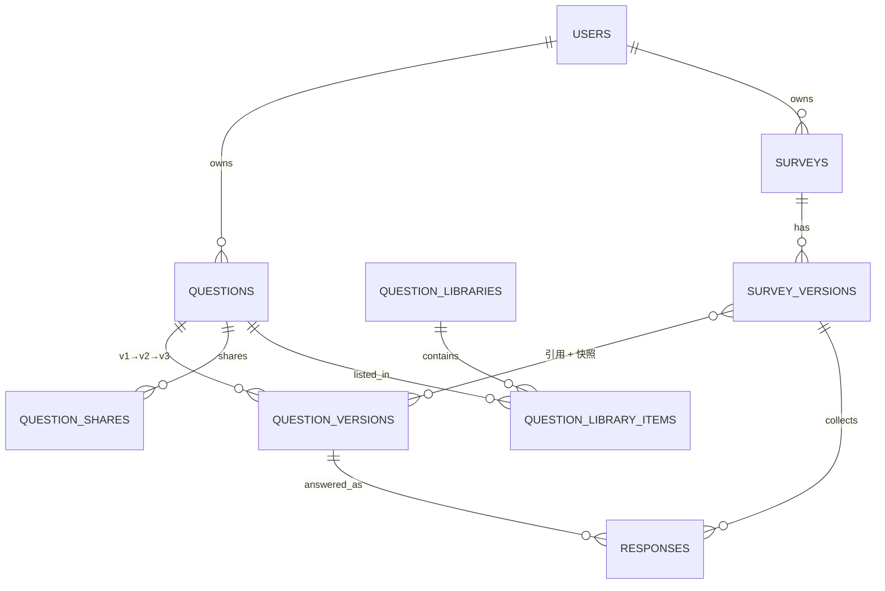

# 第二阶段 数据模型变更说明（定稿）

> 本文是第二阶段的**实现规格**：先定稿模型，再按此写代码。
> 与 `README.md`（第一阶段设计）配合阅读；冲突处以本文为准。

---

## 1. 变更总览

| 集合 | 第一阶段 | 第二阶段 |
|---|---|---|
| `users` | 不变 | 不变 |
| `surveys` | 不变 | 不变 |
| `survey_versions` | 题目内嵌，无身份 | 题目内嵌**仍是完整内容（即快照）**，新增可选 `question_ref` 指向题目实体与版本 |
| `responses` | 答案只含版本内 `question_id` | 答案新增可选 `question_ref` |
| **`questions`** | — | 新增：题目实体（身份、所有者、可见性、最新版本指针、派生来源） |
| **`question_versions`** | — | 新增：不可变题目内容快照（v1→v2→v3） |
| **`question_shares`** | — | 新增：题目共享授权 |
| **`question_libraries`** | — | 新增：题库 |
| **`question_library_items`** | — | 新增：题库条目 |
| `survey_stat_snapshots` | 可选投影 | 不变 |

**核心取舍：引用 + 冻结快照**

- `survey_versions.questions[]` 里的题目对象**仍然是完整内容**（`type/title/description/required/options/validation`），
  这就是"冻结快照"——第一阶段"一次读取版本即可展示、校验、统计"的性能结论原样保留。
- 额外挂一个 `question_ref = {entity_id, version_id}`，提供**跨问卷身份**。
- 于是：**快照负责"这一版问卷长什么样"，引用负责"这道题在全局是谁"**。
  两者的一致性由不变式 2 保证（发布时重算内容哈希比对）。

> 与初版清单的差异：清单里写的是 `snapshot: {...}` 嵌套对象，实现时改为"题目对象本身就是快照、外加 `question_ref`"。
> 理由：嵌套会让同一份内容在文档里出现两次（`type/title/...` 与 `snapshot.type/...`），既冗余又容易不同步；
> 而现有题目对象已经完整，直接复用即可。这是定稿，后续以本文为准。

---

## 2. 为什么这样改（报告必答）

### 2.1 为什么把题目拆成独立集合

第一阶段 `question_id` 是**版本内部字符串**（`q_single_0001`），只在那一个 `survey_versions` 文档里有意义。
需求一/二/四/五/六/七/八都需要"同一个题目"这个概念跨问卷存在，内嵌模型无法表达。

### 2.2 为什么"引用 + 快照"并存，而不是二选一

| 方案 | 展示/校验/统计 | 复用 | 结论 |
|---|---|---|---|
| 纯内嵌（第一阶段） | 一次读取 | 不可能 | 无法满足新需求 |
| 纯引用 | 需要按版本 `$lookup` 拼装题目，退化为 N+1 | 可以 | 推翻第一阶段的读性能结论 |
| **引用 + 快照** | 一次读取（快照） | 可以（引用） | **采用** |

代价是同一份内容存两处。用三条规则锁住一致性：
1. 问卷版本内的题目一旦带 `question_ref`，内容必须与所引用的 `question_versions.content` 完全一致（哈希校验）；
2. 想改内容 → 生成新题目版本（影响所有引用该新版本的问卷），或 fork 成新题目；
3. 发布时重算哈希，不一致直接拒绝发布。

### 2.3 为什么不用关系模型

题目内容是**判别联合**（4 种题型、各自不同的 `validation`），关系化会退化成宽表（大量稀疏列）
或 EAV（属性表，查询与约束都难写）。而"一份问卷一版内容"天然是一份文档。
多对多关系用**引用**表达，等于只借用关系建模中正确的部分（引用完整性），不承担表拆分的代价。

---

## 3. 集合定义

### 3.1 `questions`（题目实体，可变）

| 字段 | 类型 | 约束 | 说明 |
|---|---|---|---|
| `_id` | ObjectId | | 题目实体 ID，跨问卷稳定 |
| `schema_version` | int | `1` | |
| `owner_id` | ObjectId | 必填，`users._id` | 所有者；只有所有者能改题、共享、删除 |
| `root_entity_id` | ObjectId | 必填 | 血统根（自身或 fork 链的起点），用于"同族题目"查询 |
| `source_entity_id` | ObjectId \| null | | fork 来源题目（R4"新题从哪来"） |
| `source_version_id` | ObjectId \| null | | fork 时基于的来源版本 |
| `lineage_depth` | int | ≥0 | fork 代数，自身为 0 |
| `type` | enum | `single_choice/multi_choice/text/number` | 冗余：列表筛选不必读版本 |
| `title` | str | 1..500 | 冗余：最新版本标题，随新版本同步 |
| `visibility` | enum | `private/shared/public` | private 仅 owner；shared 额外授权；public 全站可用 |
| `latest_version_id` | ObjectId | 必填 | 最新版本指针 |
| `latest_version_no` | int | ≥1 | 冗余，便于排序与展示 |
| `version_count` | int | ≥1 | 版本总数 |
| `deleted_at` | datetime \| null | | 软删除 |
| `created_at` / `updated_at` | datetime | UTC | |

索引：

```text
{ owner_id: 1, updated_at: -1 }                 我的题目（列表分页）
{ root_entity_id: 1 }                           同族题目
{ owner_id: 1, type: 1, deleted_at: 1 }         按题型筛选
```

### 3.2 `question_versions`（不可变）

| 字段 | 类型 | 约束 | 说明 |
|---|---|---|---|
| `_id` | ObjectId | | 版本 ID |
| `schema_version` | int | `1` | |
| `entity_id` | ObjectId | 必填 | 所属题目实体 |
| `version_no` | int | ≥1 | 从 1 递增 |
| `parent_version_id` | ObjectId \| null | | 上一版本（v1 为 null）；**构成 v1→v2→v3 链** |
| `restored_from_version_id` | ObjectId \| null | | 由哪个旧版本"恢复"而来 |
| `content` | `QuestionContent` | 必填 | 判别联合：题型 + 标题/说明/必答/选项/校验 |
| `content_hash` | str | `^[a-f0-9]{64}$` | 内容的 sha256，用于一致性校验 |
| `created_by` | ObjectId | 必填 | |
| `created_at` | datetime | 必填 | |
| `legacy_key` | str \| null | | 迁移幂等键 `"{survey_version_id}:{question_id}"` |

**不可变**：没有任何代码路径会更新已写入的 `question_versions`（只有 insert）。

索引：

```text
{ entity_id: 1, version_no: 1 } unique      版本唯一
{ entity_id: 1, created_at: -1 }            版本历史倒序
{ parent_version_id: 1 }                    子版本
{ legacy_key: 1 } unique, partial { legacy_key: { $type: "string" } }
```

### 3.3 `question_shares`（授权）

| 字段 | 类型 | 说明 |
|---|---|---|
| `_id` | ObjectId | |
| `entity_id` | ObjectId | 被共享的题目 |
| `grantee_id` | ObjectId | 被授权用户 |
| `permission` | enum `view`/`use` | `view` 只读；`use` 可插入自己问卷 |
| `granted_by` | ObjectId | 授权人（必须是 owner） |
| `created_at` | datetime | |

索引：

```text
{ entity_id: 1, grantee_id: 1 } unique      一人一条
{ grantee_id: 1, created_at: -1 }           共享给我的
```

### 3.4 `question_libraries`（题库）

| 字段 | 类型 | 说明 |
|---|---|---|
| `_id` | ObjectId | |
| `owner_id` | ObjectId | 题库所有者 |
| `name` | str 1..120 | 同一 owner 下唯一 |
| `description` | str ≤1000 | |
| `visibility` | enum `private`/`public` | public 题库全站可浏览选题 |
| `created_at` / `updated_at` | datetime | |

索引：`{ owner_id: 1, name: 1 } unique`、`{ owner_id: 1, updated_at: -1 }`、`{ visibility: 1, updated_at: -1 }`

### 3.5 `question_library_items`（题库条目）

| 字段 | 类型 | 说明 |
|---|---|---|
| `_id` | ObjectId | |
| `library_id` | ObjectId | |
| `entity_id` | ObjectId | 引用**实体**而不是版本 → 题库里永远是"最新版本" |
| `added_by` | ObjectId | |
| `added_at` | datetime | |
| `note` | str \| null ≤500 | 题库内的备注 |
| `tags` | [str] ≤10，每个 ≤32 | |

索引：

```text
{ library_id: 1, entity_id: 1 } unique      同一题库不重复收录
{ library_id: 1, added_at: -1 }             题库列表
{ entity_id: 1 }                            此题被哪些题库收录
```

### 3.6 `survey_versions.questions[]`（改造，纯加法）

```json
{
  "question_id": "q_single_0001",
  "type": "single_choice",
  "title": "你的性别",
  "description": null,
  "required": true,
  "options": [{ "option_id": "o_male_00000001", "label": "男" }],
  "logic": { "...": "跳转规则，结构完全不变" },
  "question_ref": { "entity_id": "<ObjectId>", "version_id": "<ObjectId>" }
}
```

`question_ref` 缺失 = 第一阶段遗留题目（纯内嵌，无跨问卷身份）。

### 3.7 `responses.answers[]`（改造，纯加法）

```json
{
  "question_id": "q_single_0001",
  "type": "single_choice",
  "option_ids": ["o_male_00000001"],
  "question_ref": { "entity_id": "<ObjectId>", "version_id": "<ObjectId>" }
}
```

`question_ref` 缺失 = 第一阶段遗留答卷。

### 3.8 关系图



---

## 4. 六条不变式

| # | 不变式 | 强制位置 | 对应测试 |
|---|---|---|---|
| I1 | `question_versions` 只插入不更新，改题 = 新增 `version_no+1` | 服务层没有任何更新该集合的路径 | G1 |
| I2 | 问卷版本中带 `question_ref` 的题目，其内容哈希必须等于所引用版本的 `content_hash`；不等则拒绝保存/发布 | `replace_draft`、`publish_survey` | G1/G2 |
| I3 | 同一 `survey_versions` 内 `question_ref.entity_id` 不得重复 | `replace_draft`、`add_question`、instantiate | G2 |
| I4 | `responses.answers[].question_ref.version_id` 必须等于该答卷所引用问卷版本中该题的引用版本 | 提交时由服务端写入（客户端不传） | G4 |
| I5 | 题目被任一**已发布**问卷版本引用时不得硬删，只能软删 | `delete_question` | G2 |
| I6 | 同一题目内 `option_id` 跨版本稳定：改题时按 `label` 继承旧 `option_id`，仅新增选项分配新 ID | `create_version` 的选项合并逻辑 | G1 |

> I6 是跨版本统计能按 `option_id` 合并的前提；改名视为新选项（旧 ID 不再出现在新版本中）。

---

## 5. 命名约定（务必写进 api.md）

| 名字 | 类型 | 语义 | 出现位置 |
|---|---|---|---|
| `question_id` | str `q_xxx` | **问卷版本内部实例 ID** | `survey_versions.questions[]`、`answers[]`、`/next`、提交、单卷统计 |
| `question_ref.entity_id` | ObjectId | **题目实体 ID**，跨问卷稳定 | `/api/questions/{id}` 的 `{id}` |
| `question_ref.version_id` | ObjectId | 题目版本 ID | 版本相关接口 |
| `version_no` | int | 题目版本号；问卷版本号是另一个 `version_no`（同名不同域） | |

---

## 6. 迁移策略

### 6.1 原则

- **不丢数据、不重排**：只做"补引用"，不删除任何内嵌内容。
- **可重复执行**：以 `legacy_key = "{survey_version_id}:{question_id}"` 为幂等键。
- **可核对**：迁移前后统计结果必须完全一致。

### 6.2 步骤

1. 备份：`mongodump`（或导出 JSON），记录集合文档数。
2. 遍历 `survey_versions`（按 `_id` 升序，确定性顺序）；对每个**没有** `question_ref` 的题目：
   - 建 `questions` 文档：`owner_id = version.created_by`，`root_entity_id = 自身`，`lineage_depth = 0`，`visibility = private`，`type/title` 取题目内容；
   - 建 `question_versions` v1：`content` = 题目内容去掉 `question_id`/`logic`，`content_hash` = 内容哈希，`legacy_key` = 幂等键；
   - `$set` 该题目的 `question_ref`。
3. 建全部新索引。
4. 回填答卷：按 `survey_version_id` 分批，构建 `{question_id → question_ref}` 映射，`bulk_write` 逐条补充 `answers[].question_ref`。
5. 校验：`scripts/verify_migration.py` 输出统计对照。

### 6.3 语义说明（要写进报告）

第一阶段**不存在共享**，所以迁移时**每个 (问卷版本, 题目) 各自成为独立实体**，不做跨问卷合并——
合并需要推测用户意图（标题相同的两道题未必是同一道题），宁可保守。
因此旧数据不会自动获得"跨问卷统计"能力；该能力用于第二阶段新建的数据。

---

## 7. 跨问卷统计口径

### 7.1 能算的

- 作答人数、选项频次（单选/多选）、数字均值/最值、文本内容分页
- 涉及问卷数、涉及题目版本数

### 7.2 不算的，以及为什么

**不提供"未作答率 / 覆盖率"**。原因：跳转逻辑会导致某题"根本没被展示"，而答卷里"没有这条答案"
既可能是"没展示"也可能是"跳过"，**在数据上不可区分**。硬算会把跳转后的问卷算成大量"未作答"。
单卷统计里分母是该版本的答卷总数（口径明确），跨问卷没有这个分母，所以只报作答侧指标。

### 7.3 版本合并规则

- 默认 `version=all`：按 `option_id` 合并（依赖不变式 I6）。
- 若涉及版本的选项集不一致（某选项在部分版本不存在），响应里返回 `option_set_mismatch: true`
  并在每个选项上标注 `versions`（出现在哪些版本），前端提示"部分选项仅在部分版本存在"。
- `version=latest`：只统计引用最新版本的问卷。
- `version=<n>`：只统计该版本。

---

## 8. 兼容性矩阵

| 场景 | 第一阶段数据 | 第二阶段代码 | 结论 |
|---|---|---|---|
| 读取问卷版本 | 无 `question_ref` | 模型字段可选 | 正常 |
| 保存草稿 | — | 无 `question_ref` 的题目按内嵌处理 | 行为不变 |
| 发布 | 无引用 | 跳过哈希校验 | 正常 |
| 提交答卷 | 无引用 | 不写 `question_ref` | 正常 |
| 单卷统计 | 按 `answers.question_id` | 管道未改 | 结果完全一致 |
| 克隆新草稿 | 拷贝题目数组 | 自动带上 `question_ref` | 正常 |
| 旧 API 请求体 | 不含新字段 | 模型可选 | 行为不变 |

**红线**：`answers[].question_id`、`survey_versions.questions[].question_id`、`logic` 结构、统计管道 5 个 `$facet`，一律不改。
