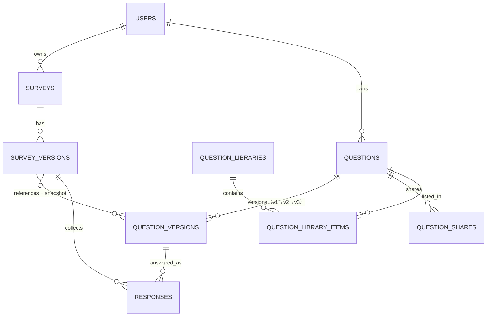

# 大作业一 第二阶段 · 代做清单

> 依据文档：
> - 《大作业一第一阶段.docx》——项目说明、技术要求、MongoDB 设计要求、AI 编程要求、测试要求、提交内容、评分标准
> - 《大作业一：需求变更.docx》——8 条新增用户需求
>
> 基线：本仓库第一阶段成果（`backend/` + `schemas/` + `tests/`），4 个核心集合 + 1 个统计投影集合，
> 本机复跑 `python -m pytest -q` → **64 passed**（用下面的命令可复现）。

---

## 0. 先看结论

### 0.1 一句话架构变化

> **把"题目"从 `survey_versions` 的内嵌数组里拆出来，变成有稳定身份的独立集合 + 不可变版本集合；
> 问卷版本改为"引用 + 冻结快照"；答卷答案补一个指向题目版本的引用。**

第一阶段的 `question_id` 只是**版本内部的字符串**（如 `q_single_0001`），跨问卷没有任何身份。
需求一（复用）、二（共享）、四（历史）、五（多版本）、六（反查）、七（题库）、八（跨问卷统计）
七条全部建立在"同一个题目"这个概念上——所以必须新增题目身份，这一步绕不过去。

### 0.2 三个必须先定的决定（不定就会返工）

| 编号 | 决定 | 推荐 | 理由 |
|---|---|---|---|
| D1 | 问卷版本里的题目，是**纯引用**还是**引用 + 冻结快照** | **引用 + 冻结快照** | 纯引用要 `$lookup` 拼装，破坏第一阶段"一次读取完成展示/校验/统计"的结论；纯内嵌无法复用。快照保住旧语义，引用提供新能力 |
| D2 | 答卷答案怎么关联到"题目版本" | 新增 `answers[].question_ref = {entity_id, version_id}`，**旧字段 `question_id` 一个不动** | 旧答卷、旧统计管道、旧 API 零改动；跨问卷统计才能走索引 |
| D3 | 同一逻辑题能否在一份问卷里出现多次 | **禁止** | 否则跨问卷统计会把同一份问卷算两次；禁掉最省事且不影响真实场景 |

### 0.3 明确"不动"的部分（这是"不得推倒重做"的证据）

- 跳转逻辑引擎（`schemas/pydantic/jump.py`、`engine.py`、`validate_response`）：**完全不动**。跳转规则按版本内 `question_id` 走，与题目身份无关。
- 发布冻结、`content_hash`、幂等发布、单文档提交、并发填写：**结构不动**（`content_hash` 内容要加题目版本 ID）。
- 统计管道的 5 个 `$facet` 分支（`backend/stats/pipelines.py`）：**不动**，跨问卷统计另写一条管道。
- 认证、权限隔离、Cookie/JWT：**不动**。

---

## 1. 需求变更 → 影响面速查

| 编号 | 用户诉求 | 本质 | 第一阶段为什么做不到 | 落点 |
|---|---|---|---|---|
| R1 | 保存常用题目、做新问卷时直接选用 | 题目成为独立实体，多对多复用 | 题目内嵌在版本里，只属于那一份问卷 | 新增 `questions` / `question_versions`，问卷版本改引用 |
| R2 | 把题目共享给同事使用 | 跨用户授权模型 | 全局只有"问卷属于 owner"一种权限 | 新增 `question_shares`（owner / shared / public 三级可见性） |
| R3 | 改题目不影响已发布问卷 | 内容不可变 + 改动即派生 | 版本已冻结，但"改题"这个动作没有定义 | 改题 = 生成新版本，禁止原地改 `question_versions` |
| R4 | 看修改历史、知道来源、能恢复 | 版本链表 | 没有题目版本概念 | `question_versions.parent_version_id` + `restored_from_version_id` + `questions.source_entity_id` |
| R5 | 同一题不同版本并存 | 问卷按版本钉住引用 | 一份问卷只有一个题目副本 | `survey_versions.questions[].question_ref.version_id` |
| R6 | 查某题被哪些问卷使用 | 反向查询 | 只能问卷 → 题目，不能反向 | `survey_versions` 上 `questions.question_ref.*` 多键索引 + `$lookup` |
| R7 | 建题库、从题库选题、题库题可升级 | 分组管理 | 无 | 新增 `question_libraries` / `question_library_items` |
| R8 | 看单题在所有问卷的统计 | 跨问卷聚合身份 | 答案只认版本内字符串 ID，无法跨问卷归并 | `answers[].question_ref` + 新聚合管道 + 新索引 |

---

## 2. 目标数据模型（先定死，再动手）

### 2.1 集合总表

| 集合 | 状态 | 职责 |
|---|---|---|
| `users` | 不变 | 账户 |
| `surveys` | 不变 | 可变元数据、状态、Slug、版本指针 |
| `survey_versions` | **改造（加法）** | 题目变为 `question_ref` + 冻结快照；`content_schema_version` 允许 1 或 2 |
| `responses` | **改造（加法）** | `answers[]` 增加 `question_ref` |
| **`questions`** | 新增 | 逻辑题目实体：所有者、可见性、最新版本指针、来源题目、血统根 |
| **`question_versions`** | 新增 | 不可变题目内容快照：题型/标题/选项/校验 + 父版本 + 版本号 |
| **`question_shares`** | 新增 | 授权：谁把哪道题共享给谁、什么权限 |
| **`question_libraries`** | 新增 | 题库元数据 |
| **`question_library_items`** | 新增 | 题库条目（题库 ↔ 题目） |
| `survey_stat_snapshots` | 不变（可选） | 统计投影 |

### 2.2 关系图



### 2.3 关键字段

**`questions`（实体，可变，只存指针和元数据）**

```json
{
  "_id": ObjectId,
  "owner_id": ObjectId,              // 所有者
  "source_entity_id": ObjectId|null, // R4：这道题是从哪道题派生（fork）来的
  "source_version_id": ObjectId|null,
  "root_entity_id": ObjectId,        // 血统根，便于"同族版本"查询
  "type": "single_choice",           // 冗余：列表筛选不用 join 版本
  "title": "你的年龄",                // 冗余：列表展示，随最新版本更新
  "visibility": "private|shared|public",
  "latest_version_id": ObjectId,
  "latest_version_no": 1,
  "version_count": 1,
  "library_count": 0,                // 可选冗余：被几个题库收录
  "deleted_at": null,
  "created_at": ..., "updated_at": ...
}
```

**`question_versions`（不可变，写一次永不改）**

```json
{
  "_id": ObjectId,
  "entity_id": ObjectId,
  "version_no": 1,
  "parent_version_id": ObjectId|null,   // R4：v1→v2→v3 链条
  "restored_from_version_id": ObjectId|null,
  "content": { "type": "single_choice", "title": "...", "description": null,
               "required": true, "options": [{ "option_id": "o_1", "label": "男" }],
               "validation": null },
  "content_hash": "sha256:...",
  "created_by": ObjectId,
  "created_at": ...
}
```

**`survey_versions.questions[]`（改造后）**

```json
{
  "question_id": "q_single_0001",          // 不变：版本内实例 ID，跳转/答案仍用它
  "question_ref": {                         // 新增：指向题目实体与版本
    "entity_id": ObjectId,
    "version_id": ObjectId
  },
  "snapshot": { "...": "发布时冻结的题目内容（与 question_versions.content 同构）" },
  "logic": { "...": "跳转规则，保持第一阶段结构不变" }
}
```

**`responses.answers[]`（改造后）**

```json
{
  "question_id": "q_single_0001",           // 不变
  "question_ref": {                         // 新增
    "entity_id": ObjectId,
    "version_id": ObjectId
  },
  "type": "single_choice",
  "option_ids": ["o_1"]
}
```

### 2.4 新增索引

```text
questions:              { owner_id: 1, updated_at: -1 }          我的题目列表
questions:              { root_entity_id: 1 }                    同族题目
questions:              { owner_id: 1, type: 1, deleted_at: 1 }  按题型筛选（可选）

question_versions:      { entity_id: 1, version_no: 1 } unique  版本唯一
question_versions:      { entity_id: 1, created_at: -1 }        版本历史
question_versions:      { parent_version_id: 1 }                子版本
question_versions:      { legacy_key: 1 } unique partial        迁移幂等键

question_shares:        { entity_id: 1, grantee_id: 1 } unique
question_shares:        { grantee_id: 1, created_at: -1 }       共享给我的

question_libraries:     { owner_id: 1, name: 1 } unique
question_library_items: { library_id: 1, entity_id: 1 } unique
question_library_items: { entity_id: 1 }                        此题被哪些题库收录

survey_versions:        { "questions.question_ref.entity_id": 1 }    ← R6 反向查询（多键）
survey_versions:        { "questions.question_ref.version_id": 1 }   ← 版本级使用
responses:              { "answers.question_ref.entity_id": 1, submitted_at: -1 }  ← R8（多键）
responses:              { "answers.question_ref.version_id": 1 }                   ← R8 版本维度
```

### 2.5 六条不变式（写进 README，测试要断言）

1. `question_versions` 一经写入不可修改，只能新增 `version_no + 1` 的文档。
2. 已发布 `survey_versions` 不可修改；发布时校验 `snapshot` 的哈希 == 引用版本的 `content_hash`。
3. 同一个 `survey_versions` 内 `question_ref.entity_id` 不得重复（防跨问卷统计重复计数）。
4. `responses.answers[].question_ref.version_id` 必须等于该答卷所引用问卷版本中该题的引用版本。
5. 题目被任一**已发布**问卷版本引用时，禁止硬删除，只能 `deleted_at` 软删除。
6. 同一逻辑题目内 `option_id` 跨版本稳定：改题时按 `label` 继承旧 `option_id`，仅新选项分配新 ID。
   → **这条是跨版本统计能按 `option_id` 合并的前提**，也是评分时的加分点。

### 2.6 命名约定（必须写进 `docs/api.md`，否则一定会踩坑）

| 名字 | 类型 | 语义 |
|---|---|---|
| `question_id`（问卷内） | 字符串 `q_xxx` | **问卷版本内部的实例 ID**，跳转规则、答案、旧 API 都用它 |
| `question_ref.entity_id` | ObjectId | **题目实体 ID**，跨问卷稳定，`/api/questions/{id}` 用它 |
| `question_ref.version_id` | ObjectId | 题目版本 ID |

> 同一个词在两处含义不同，是这次改造最容易出 bug 的地方。对外文档要显式写出区别与理由。

### 2.7 报告必须回答的三个"为什么"（MongoDB 设计 35 分的主要得分点）

1. **为什么把题目拆成独立集合，而不是继续内嵌？**
   复用/共享/版本/反查/跨问卷统计都要求"题目身份"独立于任何一份问卷；内嵌时 `question_id` 只是版本内字符串，跨问卷无法归并。引用的代价（多一次查询或 `$lookup`）用快照抵消。

2. **为什么"引用 + 冻结快照"并存，而不是二选一？**
   纯引用：展示/校验/统计要按版本拼装题目，退化成 N+1，推翻第一阶段"一次读取版本即可完成一切"的性能结论；
   纯内嵌：无法复用。
   混合方案的代价是"同一份内容存了两处"，所以必须用不变式 2（发布时哈希校验）锁住一致性——这正是"反范式冗余如何保证一致性"的答案。

3. **为什么不用关系模型？**
   题目内容是判别联合（4 种题型、各自不同的 `validation`），关系化会退化为宽表或 EAV；
   而"一份问卷一版内容"天然是文档。仍然用引用表达多对多，等于在文档库里借用了关系建模的正确部分，而没有借用它的表拆分代价。

---

## 3. 代做清单

> 勾选框按依赖顺序排。**P0 = 不做就丢分**，P1 = 明显提分，P2 = 有余力再做。

### A. 准备与基线（P0，约 0.5 天）

- [ ] **A1 建立基线快照**
  - 复制一份当前仓库为 `submission/大作业一_第二阶段_起点备份/`（或 `git tag phase1-final`），出问题可回退。
  - 完成标准：备份可运行、`pytest` 仍 64 passed。
- [ ] **A2 记录基线测试结果**
  - 跑 `python -m pytest -q`，把输出存到 `docs/第二阶段/基线测试.txt`。
  - 完成标准：文件里有 `64 passed` 与日期、环境版本，作为"旧功能未被破坏"的对照证据。
- [ ] **A3 确认运行环境**
  - Python 3.13.7、MongoDB 8.3.11（`E:\MongoDB\bin\mongod.exe`）、依赖见 `backend/requirements.txt`。
  - 测试用 `python -m pytest -q`；若本机 `mongod` 无法被测试自动拉起，先手工启动再设
    `$env:MONGODB_TEST_URI = "mongodb://127.0.0.1:27017"`。
  - 完成标准：一条命令能跑完整套测试。

### B. 设计定稿（P0，约 1 天，先写完再写代码）

- [ ] **B1 定稿 §2 的集合、字段、索引、不变式**，落到 `docs/第二阶段/数据模型变更说明.md`
  - 完成标准：6 条不变式逐条能对应到一个测试用例。
- [ ] **B2 画变更前后 ER 图**（mermaid），旧图与图并存对比
  - 完成标准：报告第 3 章可直接引用这两张图。
- [ ] **B3 写"迁移策略"一页纸**：旧数据怎么补 `question_ref`，幂等键是什么，失败怎么重跑
  - 完成标准：明确"可重复执行、结果一致"。
- [ ] **B4 定跨问卷统计口径**（关键取舍）
  - 作答数、选项频次、数字均值/最值、文本分页：可算。
  - "未作答/覆盖率"：跳转导致"未展示"与"跳过"不可区分 → **不提供**，并在文档写明原因。
  - 完成标准：口径写进 `docs/api.md` 与报告"问题与解决"章节。

### C. 数据层（P0，约 2 天）

- [ ] **C1 Pydantic 模型**：`schemas/pydantic/question_library.py`（新模块）
  - `QuestionEntity`、`QuestionVersion`、`QuestionContent`（复用现有 4 种题型判别联合）、`QuestionShare`、`QuestionLibrary`、`QuestionLibraryItem`
  - 完成标准：`python scripts/verify_pydantic.py` 通过；非法样例（版本号回退、parent 指向未来版本、空选项）被拒绝。
- [ ] **C2 JSON Schema**：`schemas/json-schema/questions.schema.json`、`question_versions.schema.json`、`question_libraries.schema.json`、`question_shares.schema.json`
  - 同步 `common.schema.json` 的公共定义（时间、ObjectId、标题长度上限复用现有常量）
  - 完成标准：`python scripts/verify_jsonschema.py` 通过。
- [ ] **C3 Mongoose 模型**：`schemas/mongoose/models/Question.js`、`QuestionVersion.js`、`QuestionShare.js`、`QuestionLibrary.js`、`QuestionLibraryItem.js`
  - 改 `models/index.js` 导出；`validation.js` 加共享常量
  - 完成标准：`node scripts/verify_mongoose.js` 通过（4 种题型 + 版本链 + 非法样例）。
- [ ] **C4 索引**：`backend/database.py::create_indexes` 增加 §2.4 全部索引
  - 完成标准：`python -m backend.init_db` 幂等执行两次无报错；`db.questions.getIndexes()` 与文档一致。
- [ ] **C5 示例文档**：`examples/questions.example.json`、`question_versions.example.json`、`question_libraries.example.json`、`question_shares.example.json`
  - 完成标准：被 C1/C2/C3 的校验脚本引用。
- [ ] **C6 `survey_versions` / `responses` 的模型扩容**
  - `schemas/pydantic/models.py`：`SurveyVersion.content_schema_version: Literal[1, 2]`；`QuestionBase` 增加可选 `question_ref` + `snapshot`；`AnswerBase` 增加可选 `question_ref`
  - `schemas/mongoose/models/SurveyVersion.js`：`content_schema_version` enum 加 2；`Response.js` 答案加 `question_ref`
  - 完成标准：**旧样例（无新字段）仍全部通过校验**，新旧样例都能过。

### D. 迁移与兼容（P0，约 1.5 天，最容易被跳过但最值分）

- [ ] **D1 写迁移脚本** `scripts/migrate_phase2.py`
  - 步骤：备份 → 遍历 `survey_versions`（按 `created_at` 排序）→ 每个内嵌题目创建 `questions` + `question_versions` v1 → 回写 `questions[i].question_ref` 与原内容 `snapshot` → 建索引
  - 幂等键：`(survey_version_id, instance_question_id)` 存在 `question_versions.legacy_key`，重复执行不产生重复文档
  - 完成标准：连续执行两次，第二次 `created=0, skipped=N`。
- [ ] **D2 回填答卷引用** `scripts/backfill_response_refs.py`
  - 按 `survey_version_id` 分批构建 `{instance_question_id → (entity_id, version_id)}` 映射，`bulk_write` 更新
  - 完成标准：空库与 10k 答卷规模都能跑完；抽查 100 条映射正确。
- [ ] **D3 迁移自检脚本** `scripts/verify_migration.py`
  - 断言：每题都有 `question_ref`；答卷答案的 `version_id` 与问卷版本一致；统计结果迁移前后完全相同
  - 完成标准：输出一份 `docs/第二阶段/迁移校验.txt`，可放进交付包。
- [ ] **D4 兼容回退路径**
  - 服务层读到没有 `question_ref` 的旧文档时不报错（视为"仅内嵌题"），保证万一迁移未跑也能只读访问
  - 完成标准：手工删掉某个版本的 `question_ref` 后，查看/统计/填写仍正常。

### E. 后端服务与 API（P0，约 3 天）

- [ ] **E1 新服务层** `backend/questions/service.py`
  - `create_question`（同时建 v1）、`list_questions`（mine / shared / library / public 四种 scope）、`get_question`（含版本列表、使用次数）
  - `create_version`（改题唯一入口）、`restore_version`（R4）、`fork_question`（R4"新题从哪来"）
  - `share_question` / `revoke_share`、`list_usages`（R6）
  - 完成标准：不改任何旧表即可单元测试（不依赖 HTTP）。
- [ ] **E2 权限模型**
  - 可见：owner、被共享者、public、题库成员；可改：仅 owner；可用：owner + `use` 权限
  - 完成标准：越权访问返回 404（不是 403，避免泄露存在性），与第一阶段问卷的权限风格一致。
- [ ] **E3 新路由** `backend/questions/router.py`
  ```text
  POST   /api/questions                       创建题目（含 v1）
  GET    /api/questions?scope=mine|shared|library|public&type=&q=
  GET    /api/questions/{id}                  详情 + 最新版本 + 版本数 + 使用数
  POST   /api/questions/{id}/versions         改题 → 生成新版本
  GET    /api/questions/{id}/versions         版本历史（v1→v2→v3 + parent）
  GET    /api/questions/{id}/versions/{no}    某版本内容
  POST   /api/questions/{id}/versions/{no}/restore   恢复旧版本（生成新版本）
  POST   /api/questions/{id}/fork             派生为新题目
  GET    /api/questions/{id}/usages           被哪些问卷使用（R6）
  POST   /api/questions/{id}/shares           共享
  DELETE /api/questions/{id}/shares/{user_id} 撤销共享
  DELETE /api/questions/{id}                  软删除（被引用时拒绝）
  ```
  - 完成标准：`/docs` 自动文档可交互；错误码与第一阶段风格一致（`code` + `message` + 上下文）。
- [ ] **E4 题库路由** `backend/questions/library_router.py`
  ```text
  POST   /api/libraries                      建题库
  GET    /api/libraries                      我的题库
  GET    /api/libraries/{id}                 题库 + 条目（含题目最新版本摘要）
  POST   /api/libraries/{id}/items           把题加入题库
  DELETE /api/libraries/{id}/items/{qid}     移出题库
  ```
  - 完成标准：同一题目可进多个题库；重复加入幂等。
- [ ] **E5 问卷侧接口扩展**（**只加不改**）
  - `POST /api/surveys/{id}/questions` 支持 `{"from_question_version_id": "..."}`：从题目版本实例化（写 `question_ref` + `snapshot`）
  - `PUT /api/surveys/{id}/draft` 支持每道题带 `question_ref`；服务端校验引用存在、不重复（不变式 3）
  - `POST /api/surveys/{id}/questions/{qid}/refresh`：草稿阶段把某题升到最新版本（R7"题库里的题可以更新版本"）
  - `POST /api/surveys/{id}/new-draft`：克隆时必须复制 `question_ref`（**别丢引用**）
  - 完成标准：五个接口的旧请求体仍然可用（不加新字段时行为与第一阶段完全一致）。
- [ ] **E6 发布校验扩容** `backend/surveys/service.py::publish_survey`
  - 校验 `snapshot.content_hash == question_versions.content_hash`（不变式 2）
  - `content_hash` 计算加入 `question_ref.version_id`（`_canonical_questions` 要改）
  - 完成标准：改题目版本后重新发布，`content_hash` 变化；未改则不变。
- [ ] **E7 跨问卷统计** `backend/stats/pipelines.py` + `service.py`
  - 管道：`$match {'answers.question_ref.entity_id': oid}`（走多键索引）→ `$unwind` → `$filter` 精确取该题 → `$facet`（作答数 / 选项频次 / 数字均值最值 / 文本分页 / 涉及问卷数）
  - 路由：`GET /api/questions/{id}/stats?scope=all|mine&version=all|latest|{no}`
  - 合并规则：按 `option_id` 合并（依赖不变式 6）；版本选项集不一致时按 `label` 兜底并在响应里标 `merged_by: label`
  - 完成标准：跨 3 份问卷、2 个版本的样例数据统计数与手工核对一致。
- [ ] **E8 提交侧写入引用** `submit_response`
  - 落库时把每题的 `question_ref` 从问卷版本复制到答案上；旧版本（无引用）不写，不报错
  - 完成标准：新答卷带引用、旧答卷仍可读。

### F. 前端（P1，约 2–3 天；本课程"前端可非常简单"，够用即可）

- [ ] **F1 我的题目页** `/questions`：列表 + 按题型筛选 + 新建 + 进入详情
- [ ] **F2 题目详情页** `/questions/{id}`：版本历史（v1→v2→v3）、当前版本内容、**改题（生成新版本）**、恢复旧版本、派生新题、共享管理、使用它的问卷列表
- [ ] **F3 题库页** `/libraries` 与 `/libraries/{id}`：建题库、加题、移题、从题库选题
- [ ] **F4 编辑器接入** `backend/static/js/editor.js` + `templates/editor.html`
  - 「从题库插入」按钮：弹窗选题目 → 插入为 `question_ref`
  - 已插入的题目显示"题目来源"标记与「更新到最新版本」（仅草稿）
  - 完成标准：从题库插入 → 改题目版本 → 旧草稿不变、刷新后才变。
- [ ] **F5 跨问卷统计页** `/questions/{id}/stats`：总作答数、涉及问卷数、选项频次（CSS 横条图，复用 `stats.js` 风格）、版本切换
- [ ] **F6 导航入口** `templates/base.html` 增加「题目库」入口
- [ ] **F7 浏览器冒烟**：注册 → 建题 → 建题库 → 建问卷 → 从题库选题 → 发布 → 填写 → 单题统计 → 跨问卷统计，全链路点一遍

### G. 测试（P0，约 2 天；测试占 10 分，且是"旧功能仍可用"的唯一证据）

- [ ] **G1 新增单元测试** `tests/test_questions.py`
  - 版本链（v1→v2→v3、parent 正确）、`option_id` 跨版本继承、恢复版本、fork、可见性判定
- [ ] **G2 新增 API 测试** `tests/test_questions_api.py`
  - 创建/改题/版本历史/恢复/fork/共享/撤销/删除保护、越权返回 404
- [ ] **G3 新增题库测试** `tests/test_library_api.py`
- [ ] **G4 新增跨问卷统计测试** `tests/test_cross_survey_stats.py`
  - 同一题目进 3 份问卷、2 个版本，核对作答数/选项频次/均值
- [ ] **G5 新增迁移测试** `tests/test_migration.py`
  - 造一份"第一阶段形态"的旧数据（内嵌题、无引用）→ 跑迁移 → 断言：引用齐备、统计结果一致、幂等
- [ ] **G6 兼容性回归（最重要的一组）**
  - 旧数据 + 新代码：查看、编辑、发布、填写、单卷统计全部正常
  - 旧请求体 + 新接口：行为与第一阶段一致
  - 完成标准：`pytest` 总数从 64 增长，且**原来 64 个用例一个都不改**（改了就没有说服力）
- [ ] **G7 并发回归**：沿用 30 并发的用例，确认提交路径没变慢/没坏
- [ ] **G8 测试结果归档**：`docs/第二阶段/pytest.txt`（`python -m pytest -v` 全量输出）

### H. 文档与 AI 记录（P0/P1，约 2 天；文档 15 + AI 15 = 30 分）

- [ ] **H1 `README.md` 数据库设计章节改写（必做，否则自相矛盾扣分）**
  - 现在第 162–171 行写的是"**为什么题目内嵌在版本中，而不是单独建 `questions` 集合**"，
    第二阶段把题目拆出来了 → 必须改写为"第一阶段为何内嵌 / 第二阶段为何拆出 / 代价与补偿（快照 + 哈希校验）"
  - 第 169–171 行已预言"第二阶段真的出现题库、跨问卷共享题目时再增加集合并按版本引用"
    → **引用这句话作为"设计早已留好演进空间"的证据**，这是很漂亮的一段
  - 新增集合全部章节：字段表、索引表、不变式
- [ ] **H2 `docs/api.md` 补新接口**：题目、版本、共享、题库、跨问卷统计；显式说明两个 `question_id` 的区别
- [ ] **H3 `docs/system-test-cases.md` 补用例表**：每行 步骤 / 输入 / 输出 / 实际结果，覆盖 R1–R8 每条
- [ ] **H4 `docs/project-report.md` + `docs/项目完成报告.docx` 重写为第二阶段版**
  - 必答（第一阶段文档「重要要求：不得推倒重做」一节明确要求，必查）：
    1. 第一阶段的设计是什么
    2. 新需求带来了哪些问题
    3. 为什么需要修改原设计
    4. 修改了哪些部分
    5. 数据结构如何变化
    6. 程序如何调整
    7. 是否遇到兼容性问题
    8. 如何保证旧功能仍然可用
  - 另加：跳转设计、校验设计、跨问卷统计口径、迁移过程与校验结果
- [ ] **H5 `docs/ai-usage-log.md` 追加第二阶段真实记录**
  - 每条：工具 → 提示词 → 得到的代码 → 是否修改 → 改了什么
  - **必须点名这些是"自己想出来的"**（AI 很容易给出纯引用的方案）：
    - 引用 + 冻结快照的混合方案与其一致性校验
    - `option_id` 跨版本按 label 继承（让跨版本统计可合并）
    - 跨问卷统计不提供"未作答率"的口径取舍
    - 迁移的幂等键设计
- [ ] **H6 报告"AI 使用说明"章节**：AI 帮了什么 / 做错了什么 / 自己改了什么 / 自己设计了什么
  - 建议如实写：AI 初始给的方案是"每题一份文档 + 全引用"，被推翻的原因（N+1、破坏旧语义）
- [ ] **H7 截图**：`docs/screenshots/` 补题目详情（版本链）、题库、编辑器选题、跨问卷统计 4 张

### I. 交付打包（P0，约 0.5 天）

- [ ] **I1 建 `submission/大作业一_第二阶段_交付包/`**，结构与第一阶段一致：
  ```text
  00_交付说明.md        README.md        .env.example
  backend/  schemas/  examples/  tests/  scripts/
  docs/                 project-report.md、项目完成报告.docx、api.md、
                        system-test-cases.md、ai-usage-log.md、screenshots/
  测试结果/              pytest.txt、schema-validation.txt、mongoose-validation.txt、
                        environment.txt、migration-verification.txt
  ```
- [ ] **I2 交付说明里写清"第二阶段的变更清单"**：新增了哪些集合、哪些接口、哪些页面、怎么迁移旧数据
- [ ] **I3 干净环境验证**：删掉 `.env`、换空数据库，按 README 从零跑一遍（含迁移脚本）
  - 完成标准：全新机器上 5 条命令能起来，测试全绿。
- [ ] **I4 自检对照评分表**（见 §5）逐项打勾，缺分的补
- [ ] **I5 压缩包 + sha256**（第一阶段有 `大作业一_第一阶段_交付包.sha256.txt`，保持一致）

---

## 4. 报告必答问题 → 章节对照

| 老师要的 | 报告章节 | 素材来源 |
|---|---|---|
| 第一阶段的设计是什么 | 1. 项目目标与阶段演进 | README「数据库设计」原始 4 集合设计 |
| 新需求带来了哪些问题 | 2. 需求变更分析 | §1 影响面表 |
| 为什么需要修改原设计 | 3. 原设计失效点 | README 162–171 行原文（内嵌论证 + 演进预言） |
| 修改了哪些部分 | 4. 变更清单 | 不变的三项 + 新增 5 个集合 + 2 个集合扩容 |
| 数据结构如何变化 | 5. 数据模型演进 | §2 前后对比 ER 图、字段表 |
| 程序如何调整 | 6. 程序改造 | 服务层/路由/前端改动 |
| 是否遇到兼容性问题 | 7. 兼容性 | 旧文档无引用、旧答卷、旧 API 请求体三种情况 |
| 如何保证旧功能仍然可用 | 8. 回归验证 | G6 用例 + 64 个原用例不改 |

---

## 5. 评分权重与取舍（总得分 = 0.3×阶段一 + 0.7×阶段二）

| 项目 | 分值 | 第二阶段对应动作 | 优先级 |
|---|---:|---|---|
| MongoDB 设计 | 35 | 新集合建模 + 引用/快照取舍 + 索引 + 6 条不变式 + 迁移幂等 | **P0，最高** |
| 后端逻辑 | 25 | 版本派生、权限、跨问卷聚合、引用完整性 | **P0** |
| 测试 | 10 | 新增 5 个测试文件 + 原 64 个用例不改 | **P0** |
| 文档 | 15 | README 改写 + api.md + 测试用例表 + 报告 8 问 | **P0** |
| AI 使用说明 | 15 | 真实日志 + "AI 错在哪、我改了什么" | **P1（性价比最高，别偷懒）** |

> 判断依据：35+25+10 是硬能力，文档和 AI 说明共 30 分靠"记录得清楚"就能拿到，
> 且不需要写代码——所以 H4/H5/H6 不要留到最后一天。

---

## 6. 红线与风险

**红线（碰了就违反"不得推倒重做"）**
- [ ] 不改跳转引擎、不重写统计管道、不删第一阶段任何功能
- [ ] 不改原有 64 个测试用例的断言（只新增）
- [ ] 不把 `responses.answers[].question_id` 改名或删除（旧答卷会读不出来）
- [ ] 不重建数据库：必须走迁移脚本，并在报告里展示迁移前后对照

**高风险点（提前想清楚）**
| 风险 | 现象 | 对策 |
|---|---|---|
| 两个 `question_id` 混淆 | 题目引用写成实例 ID，跨问卷统计查不到 | 命名约定 §2.6 + 类型标注（str vs ObjectId）+ 测试断言 |
| 编辑器保存丢引用 | `PUT /draft` 覆盖时把 `question_ref` 洗掉 | 保存前合并、后端校验引用必填（新文档） |
| 同题重复插入 | 跨问卷统计把一份问卷算两次 | 不变式 3 + 唯一约束 + 测试 |
| 改题后旧问卷变样 | `snapshot` 没冻结，实时读最新版本 | 不变式 2 + 发布时哈希校验 |
| 选项改字导致统计断裂 | 跨版本按 `option_id` 合并出错 | 不变式 6（按 label 继承 ID）+ `merged_by` 标注 |
| 迁移不可重跑 | 重复执行产生重复题目 | `legacy_key` 唯一索引 + 幂等测试 |
| 旧数据没引用也能读 | 空指针/校验失败 | E8/D4 的兼容分支 + 回归测试 |

---

## 7. 建议里程碑

| 里程碑 | 内容 | 出口标准 |
|---|---|---|
| M1（2 天） | A + B | 数据模型文档定稿，六条不变式能对应测试 |
| M2（3 天） | C + D | 迁移脚本两次执行结果一致，`verify_migration.py` 通过 |
| M3（4 天） | E | 题目/版本/共享/题库/跨问卷统计五组 API 全部可用，旧接口回归无变化 |
| M4（3 天） | F + G | 浏览器全链路走通，`pytest` 全绿且原 64 个用例未改 |
| M5（2 天） | H + I | 交付包能在空库上从零跑起来，报告 8 问齐备 |

> 顺序建议：**先把"一道题进两份问卷 → 改版本 → 两份问卷各自统计不变 → 跨问卷统计正确"这条最小链路端到端打通**，
> 再铺开前端和文档。这条链路通了，8 条需求的数据结构就都对了；链路不通就加页面，是在错误的地基上盖楼。

---

## 8. 现在就可以执行的前 5 件事

1. 跑一遍基线并把输出存进 `docs/第二阶段/基线测试.txt`（A1/A2）
2. 把 §2 抄成 `docs/第二阶段/数据模型变更说明.md`（B1）
3. 写 `schemas/pydantic/question_library.py` 的 6 个模型（C1）
4. 加 `backend/database.py` 的索引（C4，10 分钟）
5. 写 `scripts/migrate_phase2.py` 的骨架 + `legacy_key` 幂等（D1）

---

## 9. 执行记录（A–H 已完成，I 待打包）

| 章节 | 状态 | 产出与证据 |
|---|---|---|
| A 准备与基线 | 完成 | git tag `phase1-final`；`docs/第二阶段/基线测试.txt`（64 passed）、`基线环境.txt` |
| B 设计定稿 | 完成 | `docs/第二阶段/数据模型变更说明.md`（集合、字段、索引、6 条不变式、迁移策略、统计口径、兼容矩阵） |
| C 数据层 | 完成 | `schemas/pydantic/question_library.py`；5 个 JSON Schema；5 个 Mongoose 模型 + `questionRef`/`questionContent`；`backend/database.py` 新增 17 个索引；7 个示例；`verify_*` 三个脚本全通过 |
| D 迁移与兼容 | 完成 | `scripts/migrate_phase2.py`、`backfill_response_refs.py`、`verify_migration.py`；`docs/第二阶段/migration-*.txt` 显示第二次执行 `created=0`、回填 3 条、27 项断言 0 失败 |
| E 后端 | 完成 | `backend/questions/`（服务 + 路由 + 题库路由 + 错误映射）、`backend/stats/cross.py`；问卷侧新增 2 个入口 + 2 处校验 + 提交写引用；共 33 个 API 路径 |
| F 前端 | 完成 | 5 个新页面（`/questions`、`/questions/{id}`、`/questions/{id}/stats`、`/libraries`、`/libraries/{id}`）+ 7 个 JS；编辑器接入“从题库插入”与“更新到最新版本” |
| G 测试 | 完成 | 新增 7 个测试文件共 66 例；原 64 例断言未改；合计 **130 passed**；`docs/第二阶段/pytest.txt` |
| H 文档 | 完成 | README（核心结论、§2.8–2.13、§3.4 重写）、`docs/api.md` 第 7 章、`docs/system-test-cases.md` 第二部分（54 条需求级场景，对应 66 个自动化用例）、`docs/project-report.md` 重写并生成 `项目完成报告.docx`、`docs/ai-usage-log.md` 第二阶段 8 条日志。**H7 已补齐 6 张真实页面截图**：`docs/screenshots/phase2-question-library.png`、`phase2-question-detail.png`、`phase2-question-versions.png`、`phase2-editor.png`、`phase2-question-book.png`、`phase2-cross-survey-stats.png` |
| I 交付打包 | 待本人打包 | 见 §3 I1–I5 |

### 与初版清单的两处偏差（已同步到设计文档）

1. 题目对象**本身**就是冻结快照，不再额外嵌套 `snapshot` 字段——避免同一份内容在文档里出现两次；
2. 从题库插入改用独立端点 `POST /surveys/{id}/questions/from-library`，而不是扩展原端点，
   这样旧请求体的语义完全不变。
